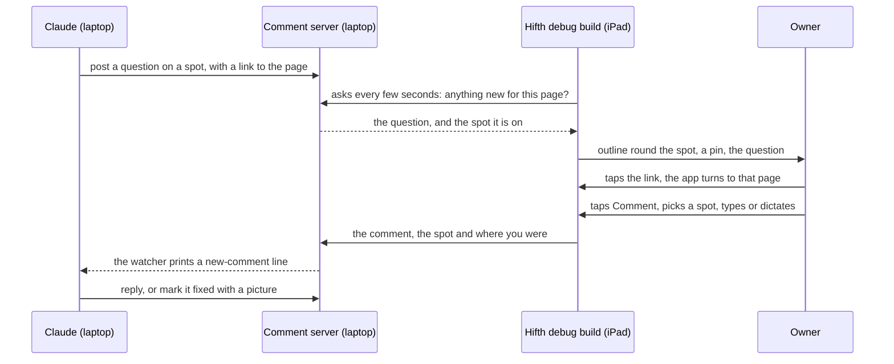

# Walking the iPad together

*Written 2026-11-12 for the owner's ask: "do we have a way to walk the iPad together, where you
open pages and highlight areas with me to take a look at, maybe even have a comment button I can
leave comments on?"* Its sister note, [Opening and checking every feature from a
link](feature-links.md), is how the laptop sends the iPad to a place and gets a picture back.

## The short version

- **Not today.** On a real iPad the laptop can only choose the page the app opens on, and that
  means restarting the app. It cannot move the page, draw on it or read anything back while the
  app runs. The live tools we have only reach the simulator.
- **Most of it is already built, for the web pages on the laptop.** The page comments tool
  (the comment bar on our local pages) already lets you tap a spot and leave a comment. It
  already shows my questions pinned on the spot they are about, with the spot outlined. It
  already checks for new ones every few seconds. And it already has a way in from a phone.
- **Recommendation: put that same comment bar into the debug build of the iPad app.**
  - Through it I open a spot by posting a question on it. You see the outline and the pin, and
    the question carries a link that takes the app to that page.
  - You tap a comment button, and I read the comment on the laptop as I read page comments now.
  - The release build gets none of it.
- **First step, about an hour, no app change:** open the laptop's dev site in Safari on the
  iPad over a private link between the two, then trade a comment each way. That proves the
  touch, the pins and the link before any Swift is written.

What exists today, measured (read in the code, 2026-11-12)

**Steering the app from the laptop**

| Way in | What it does | Real iPad, app running? |
| --- | --- | --- |
| The page to open on (`HIFTH_ROUTE`, in the install step) | opens the app on one page | **at launch only**: a new page means restarting the app |
| `hifth://` and x-callback links (`native/Hifth/Route/`) | turns the running app to a page | the laptop can send one to the **simulator** (`make app-open`). For the iPad, Apple's install tool lists a way to send one (`devicectl … --payload-url`), not yet tried ([feature-links.md](feature-links.md)). A link you tap on the iPad works. |
| The probe (`make app-probe`, `HIFTH_PROBE_EVAL`) | runs a question in the page, keeps a picture | **simulator and Mac only**, and at launch only |
| The pitch walk (`pitch-walk.mjs`) | walks a list of steps and keeps a picture of each | **simulator only**: it is handed the list at launch |
| Safari's Web Inspector | the page's console, live, over the cable | **yes, in the debug build**: the shell turns inspection on only there (`ShellModel.swift`, around line 120). But it is by hand in Safari, and nothing installed here lets a script use it. |

So the real iPad has no live way in for a script. The shell also listens on no network port and
asks for no local-network permission (none of those keys are in its settings).

**The comment bar (development-manager's page comments)**

- **Where it runs:** only in Vite's dev server (`.page-comments/vite.mjs`), or as a userscript on
  pages listed in its `config.json`. The page the iPad app shows comes from a private address
  inside the app (`hifth-app://app`), so neither reaches it.
- **What it can do** (`client/comments.js`, about 1,450 lines):
  - comment on a spot by tapping it, then "Comment here";
  - pin each comment on its spot, with the spot outlined;
  - check for new comments every few seconds while the page is in view, and swap them when the
    screen changes;
  - keep a picture of the spot with each comment.
- **The phone way in already exists.** The server takes the phone's requests over Tailscale (a
  private link between your own devices, with its own sign-in) and only from logins on an
  allow list. hifth has not switched it on, and Tailscale is not installed on this laptop.
- **I can already put a question on a spot** with the `ask-on-the-page` skill, so the "I
  highlight it" half needs no new tool.

**Overlap with the walk capture plan** (`.claude/plans/refactored-bouncing-cerf.md`)

A comment is a capture with an anchor: a note, a picture and where you were, pinned to a spot.
So build these once and share them:
- the debug-only switch;
- the reader that says where you were (page, verse, drawer, settings, build);
- the git-ignored `native/shots/walks/` folder;
- the gallery, which shows comments beside screenshots.

## What are the ways to do it?

| | A. The comment bar inside the debug build (recommended) | B. Safari on the iPad, opening the laptop's dev site | C. Leave-behind notes, copied over the cable | D. A shared screen, with no app change |
| --- | --- | --- | --- | --- |
| **How** | the debug build loads the comment bar from the laptop's comment server, over Tailscale | the iPad's Safari opens the dev site through Tailscale; the comment bar is already there | the debug build keeps comments in its own folder; I put "look here" notes in, and pull answers out, with the cable | QuickTime shows the iPad's screen on the laptop; I watch, and you point |
| **Pros** | the real app, with Pencil, the shell and the pitch build; live both ways; most of it is already built and tested | works today once Tailscale is on; a one-hour proof | no network, no new sign-in; uses the walk capture's pull as it is | nothing to build; I see what you see, live |
| **Cons** | Tailscale on both devices; the shell must be allowed to call the laptop's server; held-text care (below) | not the real app: no Pencil, no shell, and Safari's bars change the layout | not live: each round trip is a restart and a copy | I cannot draw on your screen and you cannot leave a comment; nothing is kept |
| **Commits us to** | a small change in the comment plugin, so it accepts the app's address and can keep a pitch walk's comments out of git | nothing; a stepping stone to A | a second comment format next to page comments | nothing |

**Why A:**
- It is the only one where my outline lands on the real app, and your comment lands where I
  already read comments.
- B is how we prove A's first half for an hour's work.
- C is the fallback if Tailscale is a no.
- D is worth using today, for "look at this" moments, while A is built.

## What must stay out?

- **Debug build only.** The comment bar is added only when Swift's debug switch is on. The
  release check from the walk capture plan also fails if it finds the comment bar's script or
  the server's address.
- **The book's text stays off git.** This is the one real catch, and it was found reading the
  code:
  - Comment threads are saved in `.page-comments/threads/`, and git tracks that folder.
  - A comment made on selected text stores the selected words, and the picture of the spot shows
    the page.
  - On the pitch build those words are the book's text. So a pitch walk's comments must go to a
    git-ignored folder, `native/shots/walks/comments/`, with comments on selected text turned
    off and pictures kept only on the laptop. They must not go to the cloud-synced pictures
    folder the comment tool uses now.
  - The public build can use the usual folder.
- **Only your devices.** Comments cross from the iPad to the laptop over Tailscale and nowhere
  else. Comments from the iPad need a login on the allow list.
- **Safari inspection is debug only.** It used to be on in every build; since 2026-11-12 the
  shell turns it on only in the debug build (`ShellModel.swift`, around line 120).

## In what order?

1. **Prove it in Safari (about an hour, no app change).**
   - Install Tailscale on the laptop and the iPad, and switch on the comment tool's phone way in
     for hifth.
   - Open the dev site in Safari on the iPad.
   - I post one question on a spot. You see the outline and the pin, and you leave one comment
     back with your finger.
   - Written down after: does tapping a spot work with a finger and with the Pencil, and how long
     does my pin take to show up?
2. **The comment bar in the debug build.**
   - At page load, Swift adds a small script that loads the comment bar from the laptop's server.
   - The plugin lets the app's own address call the server, through the same allow list as the
     userscript.
   - The app gets the settings it needs for this, in the debug build only.
   - A test fails if the release build has any of it.
3. **Links that turn the page, and where you were.**
   - Each question I post carries a `hifth://` link to its page.
   - Each comment you leave carries the walk capture's "where you were".
   - A test checks that tapping a link inside a comment turns the page in the shell.
4. **Pitch-safe store.**
   - When the pitch build is running, comments go to the git-ignored walk folder, and comments
     on selected text are off.
   - A test checks git ignores that folder and that a comment made there never quotes the page.
5. **One gallery.** `make walk-gallery` shows comments next to screenshots, in time order.

## Open questions, and what would answer each

### ① How can Claude show Omar a spot on the iPad, and he answer with a comment? · **open**

The plan above says: put the comment bar into the debug build, reached over Tailscale, so a
question pinned on a spot shows on the iPad and a comment left there reaches the laptop. None of
it has run on the iPad yet.

**What would answer it:** step 1 in Safari proves the pins, the touch and the round trip; step 2
proves it inside the app.

Whether the laptop can send a link to the app while it runs, without restarting it, is asked
once, in [feature-links.md](feature-links.md) ②.

### ② Can the app's private address call the laptop's server over Tailscale? · **open**

The page inside the app comes from a private address, and it may need extra settings before it
is allowed to reach an `https` Tailscale address.

**What would answer it:** step 2, with the server's log showing the app's first request.
