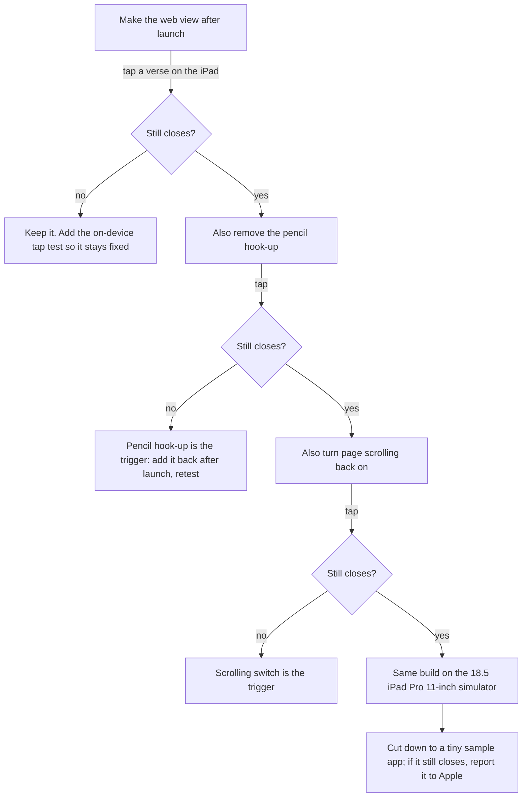

# iPad crash on touch: what to do, ranked (researcher A, design)

Written 2026-11-10 by researcher A. The evidence behind every line is in
`2026-11-10-ios-crash-troubleshooting-a-findings.md` (item numbers in brackets point there).
A second researcher answered the same questions separately; a checker will merge the two.

## The short version

- **What happens:** on the owner's iPad (iPad Pro 11-inch M4, iPadOS 18.5), touching a verse
  with a finger closes the app. Apple's own gesture code finds a gesture link with nothing on
  one end and stops the app on purpose. Removing the line that turned off pinch did not help.
- **Best guess, to test first:** our web view is made too early, before the app has finished
  starting, so UIKit's touch system is not ready for it. Two older forum threads show this
  exact error from exactly that mistake, and both were fixed by making the view later [1, 2].
  Our app makes the web view the moment the app's top-level code is built [findings, "What this
  means for us"].
- **So that the next crash explains itself:** have the app save its own last crash reason
  (MetricKit), log through the system log instead of `print`, and pull both off the iPad with
  one command each.
- **So it is caught before a device:** run the simulator tests on iPadOS 18.5 too (today they
  run only on 26.5), and add a test that taps a verse on the real iPad.



## Ranked by value for the effort

| Rank | What | Why it is worth it | Effort |
| --- | --- | --- | --- |
| 1 | Test the "made too early" guess, one change at a time | Most likely fix; each step is one build and one tap | Small |
| 2 | Save the crash reason inside the app (MetricKit) | Next crash explains itself, no cable, no luck needed | Small |
| 3 | System log instead of `print`, plus a make target to pull the iPad's log | Today nothing the app says survives unless a cable is attached at the moment | Small |
| 4 | Add a "verse tap on the real iPad" test, runnable from the command line | Would have caught this before the owner did | Medium |
| 5 | Run simulator tests on 18.5 (and 17.4) as well as 26.5 | The owner's OS is never tested today | Small |
| 6 | Send page errors across to the native log | Page-side failures are invisible on the iPad today | Small |
| 7 | Handle "the page's process died" | A blank page instead of a trace | Tiny |
| 8 | Update the native-shell skill with all of the above | So the next session does not rediscover it | Small |
| 9 | Crash reports from other people's iPads | Only once the TestFlight decision is settled | Later |

## 1. Is the web view being made too early?

**What to change.** In `native/Hifth/App/HifthApp.swift`, the line
`@State private var model = ShellModel()` builds the model, and `ShellModel.init`
(`native/Hifth/Web/ShellModel.swift`) builds the `WKWebView`, attaches the pencil interaction,
and changes the scroll view. Apple says a `@State` default value is created as soon as the
view is created [findings, State docs], and the `@main` app struct is created at the very
start of the program — before UIKit has finished launching.

Pick one of these (the first is the smallest change):

- **Make the web view lazily.** Keep `ShellModel` cheap at init; create the web view the first
  time it is asked for, from the view wrapper's `makeUIView`. By then the window exists and the
  app has launched. This also matches the visionOS poster's fix (create the web view inside the
  wrapper, not in a model handed in) [2].
- **Create the model in `.task`** on the root view, showing a plain background until it exists.
  This is what Apple's `State` page suggests for expensive work.

Then, only if it still closes, take the next step in the diagram: remove the
`UIPencilInteraction` hook-up, then turn `isScrollEnabled` back on, then try the 18.5 iPad Pro
11-inch (M4) simulator. One change per build, one finger tap per build, note the result each
time.

**How to run each step** (already in the Makefile; `--console` is what showed the reason today
[15]):

```
make app-device-install
xcrun devicectl device process launch --device "<iPad name>" --console --terminate-existing com.bytesofpurpose.hifth
```

**What would weaken the guess:** if a build from before this week took finger taps on this same
iPad without closing. The early-creation code has been there since the first shell commit, so
check the walk notes for any earlier finger tap on the real iPad before spending a day on it.

**Write it down.** Whatever the result, record it in `docs/issues/<slug>.md` (the global rule
for a pivot) and add a line to the walk checklist: "tap a verse with a finger on the real iPad".

## 2. How does the app keep its own crash reason?

**Why.** The crash report on the iPad left out the reason on purpose (privacy) [9, 11]. We got
it only because a cable and `--console` happened to be attached. MetricKit hands the app, on
the next launch, a summary of its last crash, and from iOS 17.0 (our minimum) that summary
includes the Objective-C exception's name and full reason text [25, 27, 28].

**What to add** (a new file, e.g. `native/Hifth/App/CrashInbox.swift`):

```swift
import MetricKit

final class CrashInbox: NSObject, MXMetricManagerSubscriber {
    static let shared = CrashInbox()
    func start() { MXMetricManager.shared.add(self) }

    func didReceive(_ payloads: [MXDiagnosticPayload]) {
        for payload in payloads {
            // Save the whole payload; it is JSON already.
            let url = FileManager.default.urls(for: .documentDirectory, in: .userDomainMask)[0]
                .appendingPathComponent("crash-\(Int(Date().timeIntervalSince1970)).json")
            try? payload.jsonRepresentation().write(to: url)
            for crash in payload.crashDiagnostics ?? [] {
                if let reason = crash.exceptionReason {
                    Log.crash.fault("last crash: \(reason.exceptionName, privacy: .public) \(reason.composedMessage, privacy: .public)")
                }
            }
        }
    }
}
```

Call `CrashInbox.shared.start()` once after launch. The exception reason comes from Apple's
code, not the reader, so marking it public is safe; never mark verse text or notes public.

**How to get it off the iPad** (verified flags [16]):

```
xcrun devicectl device copy from --device "<iPad name>" --domain-type appDataContainer --domain-identifier com.bytesofpurpose.hifth --source Documents --destination out/device-crashes
```

Make this a target, e.g. `make app-device-crashes`, which also pulls the system's own reports:
`--domain-type systemCrashLogs --destination out/device-crashes/system`.

**What not to do.** Do not write our own crash catcher with `NSSetUncaughtExceptionHandler` or
signal handlers. Apple's support engineer advises strongly against it: it can never be fully
reliable, and a mistake (for example calling `exit`) wipes out Apple's own report [22, 23].
If one is ever added anyway, it must only write a line and return — never `exit`, never stop
Apple's report.

**Caveat.** One forum thread says MetricKit crash summaries did not arrive on iOS 17.2–17.5
[29, snippet only]. The owner's iPad is on 18.5. If nothing arrives after a known crash, say so
in the issue file rather than assume it works.

## 3. How do we log so that a crash leaves a trail?

**Today:** every message is `print()`, which reaches the laptop only while `--console` is
attached; the declared subsystem name is unused; `make app-logs` reads the Mac's log, not the
iPad's [37].

**Change:**

1. A tiny `Log` namespace with one subsystem (`com.bytesofpurpose.hifth`, already declared) and
   a few categories — `shell`, `bridge`, `web`, `crash` — using Swift's `Logger` [34, 35].
2. Replace each `print(` in `native/Hifth` with the matching `Log.<category>.<level>(...)`.
   Keep the existing `ev=` shape inside the message so the lines stay greppable.
3. **Privacy:** anything we write ourselves (event names, route names, page numbers, counts)
   can be `privacy: .public`. Verse text, notes and anything the reader typed stay the default
   (hidden). Never log held text.
4. **Bracket the risky moment:** one log line when the web view is created and one when it is
   added to the window, plus one when the first touch reaches the page. If the "too early" guess
   is right, the log will show creation before launch finished.
5. Optional: an `OSLogPreferences` entry in Info.plist so `debug`/`info` lines are kept on disk
   for our subsystem (by default only `notice` and above are kept) [20, 34].

**Pull the iPad's log** (flags verified on this laptop [17]) — new target `make app-device-logs`:

```
log collect --device-name "<iPad name>" --last 30m --output out/device.logarchive
log show --archive out/device.logarchive --predicate 'subsystem == "com.bytesofpurpose.hifth"'
```

The iPad must be unlocked and trusted. Console.app opened with the iPad selected shows the same
lines live. Use the device's name, never its hardware identifier, in anything checked in.

**Launch with the console attached:** give `app-device-install` a `CONSOLE=1` option that adds
`--console --terminate-existing` to the launch line, so a crash prints its reason in the
terminal by default during a walk.

## 4. Can a test tap a verse on the real iPad?

Yes, from the command line. `xcodebuild` takes a real device by name [47]:

```
xcodebuild test -project native/Hifth.xcodeproj -scheme Hifth \
  -destination 'platform=iOS,name=<iPad name>' -allowProvisioningUpdates \
  -only-testing:HifthUITests/<VerseTapTests>/testFingerTapOnVerseKeepsAppAlive
```

The test: launch, wait for the page, tap a verse with `coordinate(...).tap()` (a finger, not a
pencil), wait two seconds, assert the app is still `runningForeground`. Make it a target such as
`make app-test-device`. It runs on the laptop only when the iPad is plugged in, so it belongs in
the walk, not in the push hook. (The Mac UI tests press real keys [memory note]; this one does
not, but it does take over the iPad screen while it runs.)

## 5. Which simulators should the tests run on?

- **Add 18.5.** The Makefile's default iPad (iPad Pro 13-inch M5) exists only on 26.5, so the
  owner's OS is never tested [51]. Add `IPAD_185 ?= iPad Pro 11-inch (M4)` with
  `OS=18.5` in the destination, and run `make app-test` against it as well.
- **Add 17.4** as the floor, since the app's minimum is 17.0.
- **Know what a simulator cannot show:** Apple says simulators do not replicate a real device's
  features and to test on real hardware [46]. Apple Pencil (pressure, hover, squeeze, double
  tap) is device-only; two-finger touches need the Option key on Xcode 26 and are missing from
  Xcode 27's new device window [49, snippet only]. A simulator pass on 18.5 is a good sign, not a
  proof — step 4 is the proof.

## 6. How do page errors reach the native log?

Our page talks to the shell through one message channel with three kinds today (`ready`,
`route`, `share`) [33]. Add one kind, `log`, with `{level, message, source, line}`:

- In `apps/web/src/native-bridge.ts`, when running inside the shell, listen for `error` and
  `unhandledrejection` on `window`, and post a `log` message with the message text, the script
  name and line. Do not forward every `console.log` (too noisy); forward `console.error` only,
  still calling the original so Safari's Web Inspector shows it.
- In `native/Hifth/Web/Bridge.swift`, map `log` to `Log.web.error(...)`. Keep the page's message
  hidden by default in the log (it could in principle contain text from the page), and make the
  script name and line public.
- Test it the repo's way: a unit test on the bridge's message parsing, and a page test that
  throws on purpose and checks a `log` message was posted. Use made-up text only.

For live poking, Safari's Web Inspector already works: the shell sets `isInspectable = true`;
turn on Settings › Safari › Advanced › Web Inspector on the iPad and pick the app from Safari's
Develop menu [32].

## 7. What if the page's own process dies?

The web view runs the page in a separate process. If that process dies, WebKit calls
`webViewWebContentProcessDidTerminate` [31]; we do not implement it, so the reader would see a
blank or frozen page and we would have no trace. Add it to `NavigationPolicy`: log a `fault`
line, then `webView.reload()`. This does **not** cover today's crash (which killed the app
itself), but it is the same kind of silent failure and is about five lines.

## 8. What goes into the native-shell skill?

Add to `.claude/skills/native-shell/SKILL.md`:

- **"The app closed on the iPad" recipe:** relaunch with `--console`, reproduce, read the reason;
  pull `make app-device-crashes` and `make app-device-logs`; open the `.ips` and read
  `lastExceptionBacktrace` and `asi` [10]; if the reason is missing, it was hidden for privacy
  [9, 11], so use the MetricKit file or the console.
- **Never create a `WKWebView` (or any view with gestures) in an `App` struct's stored
  properties or a model's `init` that runs at app start** — make it in `makeUIView` or later.
  Name the forum threads as the reason, and the issue file once written.
- The new targets in its scripts table (`app-device-logs`, `app-device-crashes`,
  `app-test-device`, the 18.5 simulator run), with the exact commands.
- Add "finger tap on a verse, real iPad" to the walk checklist (walk-app skill).

## 9. What about crash reports from other people's iPads?

**Today there are none to get.** Uploads to TestFlight are refused until the TestFlight licence
decision is settled [45], so the only iPad is the owner's. Items 2 and 3 above cover it fully.

**Once that decision settles** (from Apple's pages [39–43]):

- Archive with "DWARF with dSYM File" (the default for Release) and **upload symbols** with the
  build, so reports arrive with our function names. Keep every archive you upload [40].
- TestFlight testers share crashes automatically, whatever their settings [39]; they arrive in
  Xcode › Window › Organizer › Crashes, usually within moments, with the tester's comment [41].
  The owner signs into Xcode with the developer account to see them.
- App Store users share only if they have turned on Settings › Privacy & Security › Analytics &
  Improvements › Share With App Developers [43, snippet only]; reports can take up to a few
  days.
- Not sent to the Organizer: out-of-memory kills, launch timeouts, signing failures [39]. For
  those, ask the tester to share the file from Settings › Analytics & Improvements › Analytics
  Data, and the MetricKit file from item 2 still helps.
- The MetricKit file of item 2 works for testers too; a "send diagnostics" button in the info
  panel could share it by email. Not needed for the pitch.

## What this does not settle

- Whether the "made too early" guess is right. Only the step-by-step test on the iPad settles
  that.
- Whether Apple has a bug here. No Apple acknowledgement exists [7]. If the tiny sample app still
  closes with the web view made after launch, file a report with Apple with the sample attached;
  that is what Apple's engineer asked for in the closest thread [4].
- Signposts for timing (not researched in this pass [38]).
