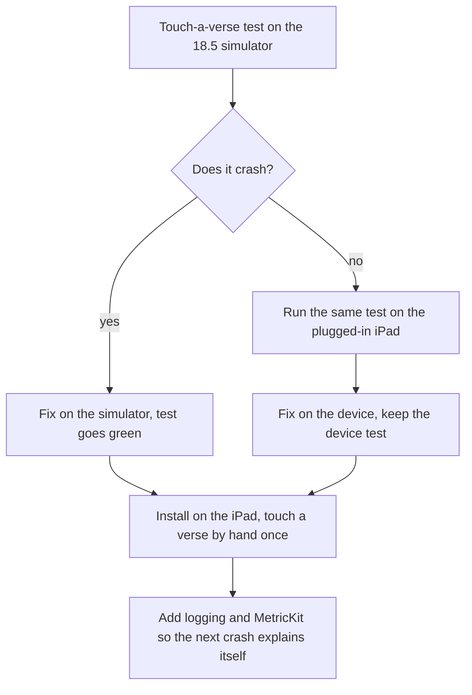

# iPad crash on touching a verse: what to do (researcher B)

Written 2026-11-10 by researcher B. The sources behind each point, and whether each was
actually opened, are in `2026-11-10-ios-crash-troubleshooting-b-findings.md`.

## The short version

- **Most likely cause (a guess to test, not a proven fact):** the app builds its web view at
  the very first moment the program starts, before the iPad has made a window for it. Two
  other developers hit this exact error on a web view, and in both the fix was to build the
  web view later or inside the view that shows it. iPadOS 18 rebuilt how the system sorts out
  competing touches, which may be why it shows up now.
- **Why our checks missed it:** every automated test runs on iPadOS 26.5. The owner's iPad
  runs 18.5. An 18.5 iPad simulator is already on the laptop and nothing uses it. And no test
  touches a verse.
- **Do first:** write a test that touches a verse on the 18.5 simulator and checks the app is
  still running. Then try two small changes, cheapest first, and keep the one that turns the
  test green.
- **Then:** make the next crash easier to read. Log the error's reason to the device's log
  before the app dies. Collect Apple's crash summaries (MetricKit) on the next launch, so a
  scholar's iPad can hand them back. Add one command that pulls everything off a plugged-in
  iPad.



## What is being decided, and what does it change for a hafiz?

How we find, fix and stop this crash, and the next one like it. For a hafiz it is simple:
today the app closes the moment they touch a verse, so it cannot be used at all on the
owner's iPad, and it cannot be shown to the team behind The Study Quran on it. Everything
below is ranked by how fast it gets a verse touchable again, and then by how much it shortens
the next hunt.

## What should we do, in order of value for effort?

| # | What | Effort | Why this rank |
|---|------|--------|---------------|
| 1 | A test that touches a verse, run on the 18.5 simulator | an hour | Says whether the laptop can reproduce it at all; becomes the guard against it coming back |
| 2 | Try the two likely fixes, cheapest first | an hour each | Directly targets the most likely cause |
| 3 | Run the iPad tests on 18.5 as well as 26.5, every push | minutes | The gap that let this through |
| 4 | Log the exception's reason before the app dies | half an hour | The reason was missing from the crash file; this puts it in the device log |
| 5 | One command to pull crash files and recent logs off the iPad | an hour | Turns today's hand steps into one line |
| 6 | MetricKit: save Apple's crash summary on the next launch, offer to share it | half a day | The only way back from an iPad that is not ours, with no TestFlight |
| 7 | Log the page's own errors and the web page process dying | an hour | Covers the half of the app that lives in the web page |
| 8 | Run the UI tests on the plugged-in iPad from the command line | half a day | Catches what simulators cannot: Pencil, real touch |
| 9 | Skill updates | an hour | So the next session does not rediscover all of this |

### 1. Can the laptop make it crash? A touch-a-verse test on 18.5

Write the test before any fix, so we watch it fail for the real reason.

- Add `testTouchingAVerseKeepsTheAppOpen` to `native/HifthUITests/SmokeTests.swift`: open at a
  page route, wait for the ready marker, tap the middle of the page
  (`web.coordinate(withNormalizedOffset: CGVector(dx: 0.5, dy: 0.5)).tap()`), wait a second,
  then `XCTAssertEqual(app.state, .runningForeground)`. Also tap a second spot and press
  and hold once, since we do not know which touch trips it.
- Run it on the matching simulator:
  `make app-test IPAD="iPad Pro 11-inch (M4)" ONLY=SmokeTests/testTouchingAVerseKeepsTheAppOpen`
  (that simulator name is on iOS 18.5 on this laptop; check with `xcrun simctl list devices`).
- If it crashes there, all the work below can happen on the laptop. If it does not, the
  device-only part (rank 8) moves up.

### 2. Which change stops it? Two small experiments

Our shell matches the pattern in both forum reports: `HifthApp` holds
`@State private var model = ShellModel()`, `ShellModel.init` builds the `WKWebView`, turns off
its scrolling and adds the Pencil listener, all before any window exists, and
`WebHost.makeUIView` hands back that already-built view.

Try in this order, one at a time, re-running the test from rank 1 after each:

1. **Attach the Pencil listener later.** Move `webView.addInteraction(pencil)` out of `init`
   and into `makeUIView` (or the first `loaded()`). Smallest change. Also tells us whether the
   Pencil code is involved.
2. **Build the web view later.** Keep one web view for the life of the app (the comment in
   `WebHost.swift` is right that it must not be rebuilt), but create it the first time
   `makeUIView` runs, not in `ShellModel.init`. In practice: make `webView` a lazily created
   property, or add a `start()` that `makeUIView` calls once. Everything that today happens in
   `init` after `WKWebView(frame:configuration:)` moves with it.

A third check if neither works: install the build from just before 2026-10-13 (commit
`17dac555`, when the Pencil listener was added) on the iPad, to see whether the crash predates
the Pencil code.

Whichever change works, keep the test from rank 1. Write a short `docs/issues/` note on the
cause, as the house rules ask, because "built too early" is invisible from reading the code.

### 3. Why did no test run on the iPad's OS? Test on 18.5 and 26.5

- `make app-test` uses "iPad Pro 13-inch (M5)" on iOS 26.5, and the iPhone checks use 26.5
  too. Our minimum is iOS 17.0.
- Add a second pass of the smoke tests on the 18.5 iPad simulator to the pre-push checks. It
  should cover, at least, the oldest OS a real reader is likely to have (18.x today) and the
  newest (26.x). The 17.4 runtime on the laptop can be a monthly check rather than every push,
  since it is slow.
- Name the simulator by model and OS in the Makefile, so the gap is visible in one place.

### 4. How do we make sure the reason is never missing again? Log it before the app dies

Apple's crash file leaves the exception's message out on purpose for some errors (privacy),
which is why ours had none. The system does print it to the device log, but only a live
console catches that easily.

- Add one `Logger` for the shell, e.g. `Logger(subsystem: "com.bytesofpurpose.hifth", category: "shell")`.
- At the start of the app, install `NSSetUncaughtExceptionHandler` and, inside it, write the
  exception's name, reason and `callStackSymbols` at **fault** level, with `privacy: .public`
  on those three (they are framework text, not reader data). Fault level is written to disk,
  so `log collect` finds it afterwards. Do nothing else in the handler: no rescue, no `exit`
  (it would stop Apple's own crash file being written).
- What this does not catch, said plainly: Swift's own stops (a nil unwrap, an index out of
  range) and memory faults are signals, not exceptions. Apple's advice is not to write our own
  signal catcher; the crash file and MetricKit (rank 6) cover those.
- Log, at notice level, the few moments around the web page and the native shell meeting:
  window ready, web view built and attached, page loaded, each message the page sends in (its
  kind only, never its text), Pencil double-tap and squeeze, route changes. Then a crash's last
  lines say what the app was doing.

### 5. What is the one command to pull everything off the iPad? `make app-device-logs`

Wrap today's hand steps in one target (script in the native-shell skill's own `scripts/`
folder, per the house rules):

```
xcrun devicectl device copy from --device "$DEVICE" --domain-type systemCrashLogs \
    --source / --destination native/shots/device-logs/crashes
log collect --device-name "$DEVICE" --last 30m \
    --output native/shots/device-logs/recent.logarchive
log show native/shots/device-logs/recent.logarchive \
    --predicate 'process == "Hifth" OR subsystem == "com.bytesofpurpose.hifth"' --style compact
```

(Check the exact `copy from` flags against `xcrun devicectl device copy from --help`; the
crash domain is the one used today.) Keep the output folder ignored by git; crash files can
carry device details. Then print the newest Hifth `.ips` file's `lastExceptionBacktrace` and
`asi` fields.

Also add `make app-device-console`: the existing launch line with `--console` and
`--terminate-existing` added, which is how today's reason was found. Note that `--console`
shows only what the app prints, so the logger from rank 4 also prints to the console in Debug
builds.

When a crash will not reproduce on the laptop and the console is not enough,
`xcrun devicectl device sysdiagnose` takes the full system snapshot; it is large and slow, so
keep it as the last resort.

### 6. How do we hear about a crash on a scholar's iPad? MetricKit, with a share button

There is no TestFlight yet (it waits on the licence decision), so the Organizer and App Store
Connect will show nothing for builds installed from the laptop. MetricKit is Apple's
in-app channel and works without TestFlight:

- Subscribe with `MXMetricManager.shared.add(_:)` at launch. On the next launch after a crash,
  iPadOS hands the app a diagnostic report. An Apple engineer tested that it arrives even with
  the "Share With App Developers" setting switched off.
- For our kind of crash, the report's `exceptionReason` (iOS 17+) carries the exception's name
  and message: the very part the crash file left out.
- Save each report's JSON into the app's files, and show a small "the app closed unexpectedly
  last time: share the report" choice that opens the system share sheet. The reader decides;
  nothing is sent on its own.
- Write a Mac unit test that feeds a saved sample report through our parser.
- Note: Apple marks these names as replaced from iOS 27.3. Use them now, behind one small type,
  and switch names when we raise the minimum.

When TestFlight is settled, it adds crash feedback with a tester's comment in App Store
Connect and the Organizer, with no code from us. The archive step must then upload debug
symbols so those reports come back readable.

### 7. What about errors inside the web page? Forward them, and notice a dead page

- In the boot script, add `window.onerror` and `unhandledrejection` listeners that send
  `{kind: "error", message, source, line}` over the existing bridge. On the native side, log
  them at error level. Mark the message public only after checking it cannot carry book text
  (if unsure, log only the source file and line).
- Implement `webViewWebContentProcessDidTerminate` in the navigation delegate: log it at fault
  level and reload the page. This would not have caught today's crash, which was in the app,
  not the page process. It does stop a silent blank page when the page process dies.
- Web Inspector already works on the device (`isInspectable` is on); turn on Settings >
  Safari > Advanced > Web Inspector on the iPad to use it.

### 8. What can only the real iPad show? Run the UI tests on it

- Simulators cannot produce Apple Pencil touches, double-tap or squeeze. XCUITest has no
  stylus API. A real finger and a real Pencil on real hardware remain the only full check.
- Add `make app-test-device DEVICE=…`: the same signing as `app-device-install`
  (`-allowProvisioningUpdates DEVELOPMENT_TEAM=$(TEAM)`), with
  `xcodebuild test -destination 'platform=iOS,id=<id>'`. Find the id with
  `xcodebuild -showdestinations`, because the one `devicectl` prints may not match. Developer
  Mode must be on.
- The house note says the Mac UI test presses real keys. The iPad one taps the screen of a
  plugged-in iPad, so it runs only while the owner is not using it.
- Add the Pencil checks (double-tap, squeeze, writing with the Pencil on a verse) to the
  manual-testing list, not to the owner's to-do. If a Pencil-specific fault ever needs an
  automated test, Lyft's open-source Hammer library can fake stylus touches on an iPad; not
  worth it yet.

### 9. Which skills should learn this?

- **native-shell**: the device commands from ranks 5 and 8; "a crash file with no reason:
  launch with `--console` or read the device log"; how to read `lastExceptionBacktrace` and
  `asi`; symbolicating with Xcode or `CrashSymbolicator.py`.
- **walk-app**: add "touch a verse with a finger, then with the Pencil, on the oldest iPadOS
  we support" to the growing checklist.
- **testing**: the 18.5 simulator pass, and the rule that a device-only crash gets a
  simulator test first, then a device test if the simulator cannot show it.

## What does this not settle?

- It does not prove the cause. The two forum reports and our code line up, but nobody at
  Apple has explained the error, and I found no WebKit bug for it. The test in rank 1 and the
  experiments in rank 2 are what decide it.
- It does not choose a third-party crash service. Apple's own advice is to rely on its crash
  files and MetricKit, and the pitch build is private.
- It does not settle TestFlight; that waits on the licence decision.
