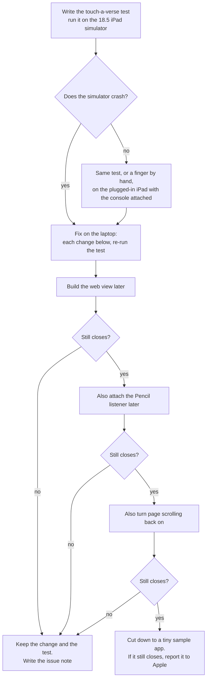

# Why does the iPad app close when a verse is touched, and how do we catch the next crash sooner?

Written 2026-11-10 by the checker, after two researchers answered the same question on their
own. **This is the page to act on.** The two research passes stay as the record it was built
from:

- researcher A: [findings](2026-11-10-ios-crash-troubleshooting-a-findings.md) ·
  [plan](2026-11-10-ios-crash-troubleshooting-a-design.md)
- researcher B: [findings](2026-11-10-ios-crash-troubleshooting-b-findings.md) ·
  [plan](2026-11-10-ios-crash-troubleshooting-b-design.md)

## The short answer

- **What happens.** On the owner's iPad (iPadOS 18.5), touching a verse with a finger closes
  the app. Apple's own touch-handling code finds a link between two gestures with nothing on
  one end, and stops the app on purpose. Turning the pinch handler back on did not help.
- **Best guess, not yet proven.** Our app builds its web view at the very first moment the
  program starts, before iPadOS has finished starting the app. Two other developers hit this
  exact error on a web view, and both fixed it by building the web view later. Both
  researchers found this on their own; the checker re-read both threads.
- **Why our tests missed it.** Every simulator test runs on iPadOS 26.5; the owner's iPad runs
  18.5. And no test touches a verse.
- **Do first:** a test that touches a verse on an 18.5 simulator, watched failing. Then move
  the web view's creation later, one change at a time.
- **So the next crash explains itself:** keep the crash's reason (Apple leaves it out of the
  crash file on purpose), log through the system log instead of plain printing, and pull both
  off the iPad with one command.

### What to do, in order

| # | What | Effort | Both agree? |
|---|------|--------|-------------|
| 1 | A test that touches a verse, on the 18.5 iPad simulator | an hour | yes |
| 2 | Build the web view later (when the screen asks for it), then re-run the test | an hour | yes, but disagreed on order; see below |
| 3 | If still closing: attach the Pencil listener later; then turn page scrolling back on | an hour each | yes |
| 4 | Read the device's own log right after a crash; the reason may already be there | minutes | checker's addition, from Apple's page |
| 5 | Run the iPad simulator tests on 18.5 as well as 26.5 | minutes | yes |
| 6 | Log through the system log; keep the crash reason with MetricKit (Apple's built-in crash summary) | half a day | yes |
| 7 | One command to pull crash files and logs off a plugged-in iPad | an hour | yes |
| 8 | Send the page's own errors to the native log; reload a page whose process died | an hour | yes |
| 9 | Run the touch test on the plugged-in iPad itself | half a day | yes |
| 10 | Crash reports from other people's iPads | later | yes: waits on the TestFlight decision |

### The order of experiments

## A few words used here

- **Crash file (.ips):** the file iPadOS writes when an app dies. It is JSON inside.
- **Exception:** an error object Apple's code throws when something impossible happens. If
  nothing catches it, the app is stopped on purpose.
- **The reason:** the one-line message carried by the exception. Here:
  "Invalid parameter not satisfying: targetNode".
- **System log:** the log every Apple device keeps; the laptop reads it with Console.app or
  the `log` command.
- **MetricKit:** an Apple framework that hands the app, on its next launch, a summary of its
  last crash.

<strong>Where did the two researchers agree?</strong>

Each line was re-checked by the checker against the source on 2026-11-10.

| Claim | A | B | Checker |
|---|---|---|---|
| The same error on a web view was caused by building it too early (forum thread 61432, 2016). Accepted answer: the web view was made in `+load`; making it one second later stopped the crash. A second poster built the window in the app delegate's `init`; a third built a view with gestures in `+load` and fixed it by creating it after launch. No Apple reply. | fetched | fetched | **Confirmed.** Re-read 2026-11-10. |
| Same error on a web view in visionOS (thread 784931, 2025): the web view was built and held by an app-wide model and handed to the SwiftUI wrapper; letting the wrapper make its own web view fixed it. The poster did not know why. No Apple reply. | fetched | fetched | **Confirmed.** Same shape as ours: `HifthApp` holds `ShellModel` as state, `ShellModel.init` builds the web view, the wrapper returns that pre-built view. |
| No WebKit bug, Apple reply, or Pencil-related report names this error. | searched | searched | Not re-searched; two independent empty searches. |
| iPadOS 18 merged the UIKit and SwiftUI gesture systems (WWDC24 session 10118). | snippet | fetched | **Confirmed verbatim:** "The gesture systems have been unified in UIKit and SwiftUI … In iOS 18, dependencies can be specified between gestures, across both frameworks." That this is *why* an old fault returns on 18 is inference in both docs; no source says so. |
| Apple leaves the reason out of the crash file on purpose for some errors. | fetched | fetched | **Confirmed:** "The crash report excludes the exception message for some errors to prevent disclosing private information about the person using the app." ("Addressing language exception crashes".) |
| MetricKit's crash summary carries the exception's name and full message from iOS/iPadOS 17.0. | fetched | fetched | **Confirmed** from the page's own platform list: introduced 17.0, marked replaced from 27.3. Our minimum is 17.0. |
| Apple's support engineer strongly advises against writing your own crash reporter, and never to call `exit` (it wipes Apple's report). | fetched | fetched | **Confirmed** (thread 113742). |
| The page-process-died callback would not have caught this crash (it was the app's own process), but is worth adding. | fetched | fetched | Agreed; small. |
| Safari's Web Inspector already works on the device (the shell sets it inspectable). | fetched | fetched | Agreed. |
| `--console` on the device launch is what showed the reason today. | verified locally | verified locally | Agreed. |
| TestFlight testers share crashes regardless of their settings; nothing to collect until the TestFlight decision settles. | fetched | fetched | Agreed. |

<strong>Where did they disagree, and which side does the source support?</strong>

### Should we add our own last-moment exception logger?

- **A:** no. Do not use `NSSetUncaughtExceptionHandler` at all; cites Apple's support engineer
  against home-made crash reporters.
- **B:** yes, a narrow one: write the exception's name, reason and stack to the system log at
  the highest level, then return. No rescue, no `exit`.
- **Source:** Apple's own page for that function says it exists so "you can perform last-minute
  logging before the program terminates". The support engineer's warnings (thread 113742)
  are about *signal* handlers (which may only call a tiny set of safe functions) and about
  anything that stops Apple's own report; that post does not mention this function. A also
  attributed "Exceptions are supposed to crash the app" to Apple's engineer; on the page
  (thread 767645) it is a forum member, Etresoft.
- **Settled: B's narrow version is allowed**, but it is not the first step. Apple's page also
  says the system's own handler "logs the exception message to the console before terminating
  the process". So pulling the device log right after a crash may already show the reason with
  no new code (rank 4). Try that first; add the logger only if the reason is not in the log.
  Whatever is added must only log and return.

### Which comes first: the test, or the fix?

- **A:** change the web view to be built later first, then test on the iPad by hand.
- **B:** write a touch-a-verse test on the 18.5 simulator first; then try *Pencil later* first
  (smallest change), then *web view later*.
- **Settled: B's test first, A's fix first.** The repo's rule is that a fix ships with a test
  watched failing first, so the test leads. For the first fix, both forum threads point at
  *when the web view is built*; nothing outside points at the Pencil listener. So build the
  web view later first; moving the Pencil listener is the next step if that does not do it.

### How to run a UI test on the real iPad

- **A:** `-destination 'platform=iOS,name=<iPad name>'`, read from `man xcodebuild` on this
  laptop.
- **B:** `platform=iOS,id=<device id>`, from community snippets only; warns that the id
  `devicectl` prints may not be the one `xcodebuild` wants.
- **Settled: A's form** (local manual page). Keep B's warning as unchecked; if a name fails,
  `xcodebuild -showdestinations` lists what it accepts.

### Which simulator to name for 18.5

- **A:** "iPad Pro 11-inch (M4)". **B:** the same, by name.
- **Checker:** that name exists only on 18.5 on this laptop today, but names can repeat across
  versions (two "iPad mini (A17 Pro)" exist). A simulator named for the job, "Hifth iPad 18.5",
  now exists and leaves no doubt. Use that.

<strong>What did only one researcher find?</strong>

| Found by | Claim | Fetched? | Checker |
|---|---|---|---|
| B | Apple's engineer tested that MetricKit crash summaries arrive even with "Share With App Developers" and "Share iPad Analytics" off; test it by launching from the Home screen, not from Xcode (thread 784399). | fetched | **Confirmed**, with a limit: one engineer, one device, iOS 18.3.1. Not a promise. |
| A | MetricKit crash summaries did not arrive on iOS 17.2 to 17.5 (thread 806457). | **snippet only** | Not checked. Not our version (18.5). If nothing arrives after a known crash, say so; do not assume it works. |
| A | `log collect --device-name … --last 30m` copies the iPad's system log to the laptop. | verified locally | **Confirmed** from `log help collect`. Two traps: in the zsh shell, `log` is a built-in maths command, so call `/usr/bin/log`; and outside sources (snippet only) say it may need `sudo` and an unlocked, trusted iPad. |
| A | The app's subsystem name is declared but unused; every message is `print`, which reaches the laptop only while `--console` is attached; `make app-logs` reads the Mac's log, not the iPad's. | read locally | Agreed by reading the Makefile. |
| A | `devicectl … copy from` can also pull the app's own files (`appDataContainer` with the bundle id), so a MetricKit file saved by the app can come off the iPad the same way. | verified locally | **Confirmed** from `--help`. |
| B | The Pencil listener was added 2026-10-13 (commit `17dac555`); installing a build from before that tells whether the crash predates it. | read locally | Confirmed in the history. A fallback check. |
| B | `xcrun devicectl device sysdiagnose` takes a full system snapshot; last resort. | read locally | Not run. |
| B | Lyft's "Hammer" library can fake Pencil touches on an iPad. | snippet only | Not checked; not needed now. |
| B | Show the reader a "the app closed last time: share the report" choice that opens the share sheet; nothing sent on its own. | design idea | Reasonable for testers later; not needed for the pitch. |

<strong>What does the guess still not explain?</strong>

- Both researchers noted that the early-built web view has been in the code since the first
  shell commit (2026-09-29). If the app ever took finger taps on this iPad before, the guess
  weakens. The history cannot say: the paid signing team arrived 2026-11-08, and the three
  files that build the web view have not changed since 2026-10-13 apart from the pitch walk
  (2026-11-09). **Open question for the owner:** had a finger ever touched a verse in the app
  on this iPad before this week?
- Nobody at Apple has explained the error. The forum fixes are workarounds whose posters did
  not know why they worked.
- Simulators do not reproduce everything a real iPad does (Apple says so), and Pencil, squeeze
  and hover are device-only. A pass on the 18.5 simulator is a good sign, not proof; the
  touch on the real iPad is the proof.

<strong>How do I get the crash file and the reason off the iPad today?</strong>

The steps that work with the tools already on the laptop are in the `crash-logs` skill
(`.claude/skills/crash-logs/SKILL.md`). In short:

1. List crash files: `xcrun devicectl device info files --device <device-id> --domain-type systemCrashLogs`
2. Copy one: `xcrun devicectl device copy from --device <device-id> --domain-type systemCrashLogs --source <file>.ips --destination <path>`
3. Read it: first line is a short JSON header, the rest a JSON body. Look at `exception`,
   `asi`, `lastExceptionBacktrace`, `faultingThread`, `usedImages`, `captureTime`.
4. Get the reason by reproducing with the console attached:
   `xcrun devicectl device process launch --console --terminate-existing --device <device-id> com.bytesofpurpose.hifth`
5. Copy the system log: `/usr/bin/log collect --device --last 30m --output <path>.logarchive`

<strong>What should change in the app, in detail?</strong>

None of this is built yet. The main session owns the app's code; this is the list.

1. **Build the web view later.** Keep `ShellModel` cheap to create; build the web view the
   first time the screen's wrapper asks for it, and keep that one web view for the life of the
   app (it must not be rebuilt). Everything `init` does after creating it moves with it.
2. **The touch test.** In the iPad smoke tests: open at a page, wait for the page to say it
   is ready, tap the middle of the page with a finger, wait, assert the app is still in the
   foreground. Also tap a second spot and press and hold once. Run with
   `make app-test IPAD="Hifth iPad 18.5" ONLY=SmokeTests/<test>`.
3. **18.5 in the regular test run**, beside 26.5. 17.4 (the oldest on the laptop) can be an
   occasional check.
4. **System log.** One subsystem (`com.bytesofpurpose.hifth`, already declared), a few
   categories (shell, bridge, web, crash). Replace `print`. Mark only our own words public
   (event names, routes, page numbers); never verse text, notes or anything the reader typed.
   Log at notice level or higher anything we need after a crash: debug and info lines are not
   kept on disk by default. Bracket the risky moments: web view built, web view on screen,
   first touch reaches the page.
5. **MetricKit.** Subscribe once after launch; save each crash summary as JSON in the app's
   files; log the exception's name and message. Apple renames these types from 27.3; keep them
   behind one small type.
6. **A narrow exception logger,** only if rank 4 shows the reason is not in the device log:
   log and return, nothing else.
7. **Page errors** (`error`, `unhandledrejection`) sent over the existing bridge as a new
   message kind; the page's message stays hidden in the log unless it cannot carry book text.
8. **Page process died:** log it and reload.
9. **On-device test target** for the touch test, run when the iPad is plugged in and the owner
   is not using it.
10. **Later, with TestFlight:** upload debug symbols with every archive and keep every archive,
    so crash reports from testers come back readable.

## What this does not settle

- Whether the guess is right. Only the test and the one-change-at-a-time experiments settle
  that. Whatever they show goes in a note under `docs/issues/`.
- Whether Apple has a bug. If a tiny sample app with the web view built after launch still
  closes, report it to Apple with the sample attached.
- Third-party crash services: left out on purpose; Apple's own crash files and MetricKit
  cover a private pitch build.
- Signposts (timing marks for Instruments): neither researcher looked.
