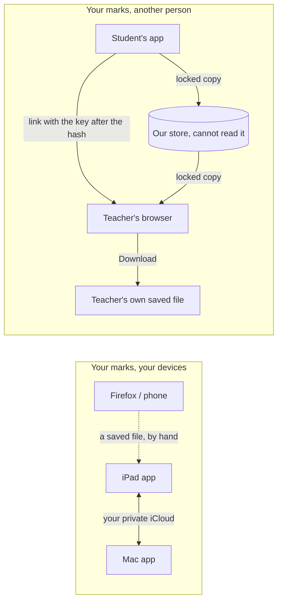
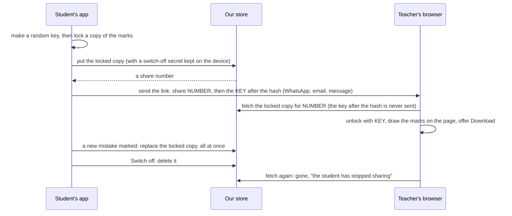

# How could a student send their mistake marks to a teacher, and how would people sign in to do it? (researcher A)

> [!tip] Short version
> **Two questions hide in one.** Your own marks following you from the iPad to the Mac is one. Sending your marks to another person is another, with a different kind of consent. Keep them apart.
> **Your own iPad and Mac:** use your own iCloud, on the same machinery you already chose for the usage counts. The paid Apple membership that blocked it was bought today. Firefox and the phone keep joining by a saved file.
> **Sending to a teacher:** you already said what it should feel like (2026-11-08). It is a live link the student starts and can switch off, and its page has a download button for the teacher. So the question is where the shared copy lives.
> **Recommended, in one line:** the student's app locks a copy of the marks and puts it in a small store of ours that cannot read it. The key travels only inside the link. Switching off deletes the copy. Start with no accounts at all, and add Sign in with Apple and email links only when a student needs to switch a link off from a second device.
> **Not iCloud sharing:** Apple requires every person in a share to have an iCloud account, and Apple's web library for browsers has open, unanswered failures this year. A teacher on Android or Firefox would be left out.
> **Separate site?** For a link with no accounts, no. Once people sign in, yes: the signed-in part belongs on its own address, such as `hifth.bytesofpurpose.com`, not under the blog's `/hifth/` path. The reasons are below.

The raw sources, each marked as fetched or only seen in a search snippet, are in [research.md](research.md) next to this note.
Written 2026-11-08 by researcher A of two; a checker will compare this with researcher B's note. No app code was changed.

## Words used here

- **Your marks:** what the app keeps for one reader: the mistakes marked with the Mistake pen, the notes, the bookmarks, and the slips from one verse into a similar one. They are all in one saved file today.
- **The revision record:** the app's private log of when you revised and what you kept going back to. It is kept apart from your marks on purpose, and a check in the build refuses any code that could send it anywhere.
- **iCloud:** Apple's online storage tied to your Apple account. It comes as a private database (only you), a shared database (records someone shared with you), and iCloud Drive (the folder in Files and the Finder).
- **Our store:** a small online database the project would run. One already exists for another purpose (Supabase, below).
- **A locked copy:** the marks scrambled on the student's device with a key only the link carries. Our store keeps the scrambled copy and cannot read it.
- **Sign-in:** proving who you are to the app. Each way of signing in hands the app some facts about you, and the screen that asks your leave lists them. That list is what the owner called the "OAuth scopes".
- **Hafiz, huffaz:** someone who has memorised the Qur'an, and the plural.

## What does it change for a hafiz and their teacher?

**Today.** A student tells the teacher in words where they keep slipping, or hands over the iPad. The teacher drills from memory of past lessons.

**With sharing.** A student sends one link before the lesson. The teacher opens it on their own phone and sees the student's mistakes and slips drawn on the page. Mistakes are the words marked wrong; slips are the arrows from a verse into its look-alike. So the drilling starts at the verses this student keeps falling on, not at the ones the teacher happens to remember. Because the link stays live, a mistake marked on Tuesday is on the teacher's screen by Thursday's lesson. The student can switch it off when the lessons end. The teacher can save a copy with the download button.

**What it must not do.** It must not show the teacher *when* the student revised, unless that is decided on its own (question ② below). A teacher seeing "revised at 3 in the morning, skipped Monday" is a different thing from a teacher seeing "slips from this verse into that one".

**Your own iPad and Mac.** A mistake marked on the iPad in the masjid is there on the Mac at home, with no file to carry.

## Why are these two questions and not one?

The project's rule on where a reader's record lives says exactly this. One reader's own record lives on the device, can be saved to a file, and gets the reader's own cloud copy once there is sign-in. A record "genuinely shared between people — teacher and student, say — is a different decision about identity and consent … it starts its own."
So the left half is a step the project has already decided on. The right half needs a new decision. It does not reopen an old one.

## How do your marks follow you from the iPad to the Mac?

This is the left half, and it is short because it is mostly decided.

- **The owner picked the same road for the usage counts on 2026-10-11:** the two Apple apps keep in step through the owner's own private iCloud database, and Firefox and the phone join by a file. Its build waited on the paid Apple membership, which was bought and became active on 2026-11-08.
- **Your marks ride on the same machinery.** Each kind of mark becomes a record in your private iCloud database. Apple's ready-made sync helper keeps the two apps in step. It needs iOS 17 and macOS 14, the same versions the apps need already.
- **Who can see it:** you, on your devices. It is in your Apple account and uses a little of your iCloud space. The app's maker cannot read your private database.
- **What it costs:** the iPad and Mac apps are thin shells around the web app. So the web app hands each change to the shell, and the shell writes it to iCloud. The privacy check will need a named exception for that hand-off, the same one the usage counts already need.
- **What it does not reach:** Firefox and Safari on the phone. They keep using the saved file, which already works, including inside the Apple apps since the fix closed by `native/HifthTests/DownloadTests.swift`.

## What are the ways a student could send marks to a teacher?

Six options. A and B work without anything online, so neither can be live or be switched off. C is Apple's own sharing. D, E and F are three sizes of a store of our own.

| | A. A file sent by hand | B. A link that carries the marks inside it | C. iCloud sharing | D. A live locked link, no accounts | E. D, with the student signed in | F. Accounts for both, a teacher's list of students |
| --- | --- | --- | --- | --- | --- | --- |
| **How** | The student saves the file the app already makes and sends it by AirDrop, WhatsApp or email. The teacher opens it in the app as "someone else's marks", shown apart from their own | The marks are packed into the link itself, after the `#`, which a browser never sends to any server | The student's app shares a record from their private iCloud with the teacher's Apple account, through the system's share window | The student's app locks a copy and puts it in our store. The key goes only in the link. Each new mark rewrites the copy. "Switch off" deletes it | As D, but the student signs in once, so their links belong to their account and not to one device | Both sign in. A teacher sees every student who has joined them, as a list |
| **Live?** | No, a snapshot | No, a snapshot | Yes | Yes | Yes | Yes |
| **Can the student switch it off?** | No; a sent file is gone | No | Yes | Yes, from the device that made it | Yes, from any device | Yes |
| **Teacher with no Apple device** | Yes, in any browser | Yes | **No.** Apple: "each participant must have an active iCloud account" | Yes | Yes | Yes, with an account |
| **Who can read it on the way** | Whoever carries the file (the chat app, the email provider) | Whoever sees the link; no server sees the marks | Apple holds it, the people shared with read it | Our store holds only a locked copy. Anyone holding the link can read it | Same as D. Our store also knows the student's account | Our store holds and can read it, unless locked per teacher, which is harder |
| **Pros** | Built already; nothing online; the download button in D, E and F would make this same file | No server, no account, no cost | Apple's own share window, its own "who can see this" screen, no store of ours | Meets the owner's live, switch-off and download wish. The teacher needs no account. Our store cannot read the marks. Small to build | All of D, and a lost phone does not leave a link that cannot be switched off | The full classroom: a teacher sees all their students without collecting links |
| **Cons** | Not live; the student cannot take it back | Not live; a large set of marks makes a link too long for some chat apps; cannot be taken back | Leaves out teachers without Apple devices. Raw share links break in non-Apple browsers (snippet). The web library had two unanswered failure reports in 2026 and cannot read locked fields | Anyone the link is forwarded to can read it, as with Google's "anyone with the link". Lose the device and the link stays on until it expires | Accounts to run; the sign-in screens; the address question below becomes real | Most work by far. Our store reads everyone's marks. Needs a privacy policy and a deletion path; a step change in what the project holds |
| **Implications** | Nothing new to decide | The cheapest way to try the teacher's view before anything else exists | Couples sharing to Apple for good; a second road would still be needed for everyone else | Needs a store that never sleeps (the free Supabase plan pauses after a quiet week). The privacy check gains one named exit | Forces the sign-in choice (below) and the separate-address choice | Opens identity, consent between two people, and holding readable personal records, all at once |

**Recommended:** D, built so E can be added later without changing the link. It is the smallest thing that meets what the owner asked for: live, switched off by the student, downloadable by the teacher, and open to any teacher's browser. The teacher's view and its download button can be tried first with B, which needs no store at all.
Why not C: it is the most polished on Apple devices and the only one that shuts out some teachers outright.
Why not F now: it turns the project into one that holds readable records of people's worship, which nothing so far needs.

### How would the live locked link work?

This is the pattern Excalidraw uses for its shared drawings (fetched; see research.md). The store holds the copy; the key never reaches it.

## What would each way of signing in let us see?

Only E and F need sign-in. In plain words, here is what each way asks the reader to agree to share with the project.

| way to sign in | what the reader agrees to share with us | works for | catch |
| --- | --- | --- | --- |
| **Sign in with Apple** | their name (once, on the first sign-in only) and an email address, which can be a random Apple forwarding address that hides their real one. Apple says it "won't track or profile you" | any device; on Android and Windows through an Apple web page. Needs an Apple Account | one user report of trouble in Firefox on Windows (snippet). The app gets the name only once, so it must keep it |
| **Google** (`openid`, `email`, `profile`) | "your primary Google Account email address" and "your personal info, including any personal info you've made publicly available" (name, picture). These three need no review by Google (snippet) | anyone with a Google account | **Google refuses sign-in inside an app's built-in web view, which is what the iPad and Mac apps are.** There it must open in the system browser or Apple's sign-in window. More than we need: we want an address, not a picture |
| **An email link** (a one-time link or code by email) | their email address, and nothing else | everyone with an email address | the email has to arrive; a little slower |
| **Passkey** (the phone's own face or fingerprint unlock) | nothing beyond a key for this one site | modern browsers and devices | Supabase's support is "experimental". A passkey is tied to one address for good, so the address must be chosen first |
| **No sign-in (D)** | nothing; the device keeps a secret for each link it made | everyone | switch off only from the device that made the link |

A Qur'an app that already asks this leave in pieces is quran.com's Quran Foundation. It asks separately for bookmarks, notes, "publish your notes", reading sessions, streaks, `sync`, and following other people (fetched). Its list is a good model of how narrow each ask can be.
**Suggested if E comes:** Sign in with Apple and an email link. Google can come later, through the system browser in the Apple apps. Passkeys come once Supabase's support settles.

## Does it need a separate site?

**Short answer:** not for D. For E and F, yes: a sub-address of its own, such as `hifth.bytesofpurpose.com`, served from the Cloudflare setup the project already keeps ready. The blog's `/hifth/` path is the wrong home for it.

Why, one reason per line:

- **A site is its host, not its path.** Browsers keep one store for everything on `blog.bytesofpurpose.com`, whatever the path (fetched, MDN). Today any page on the blog, or any script one of those pages loads, could read the reader's saved marks. Most do not, but it is possible. Add a sign-in token to that store and the blog's pages could act as the reader. On an address of its own, only Hifth's code shares the store.
- **Links that open the app need a file at the root of the host.** Apple wants it at `https://<host>/.well-known/apple-app-site-association`, with no redirect (fetched). The root of `blog.bytesofpurpose.com` belongs to the blog, not this repository, and it returns nothing there today. On an address of its own, this repository controls the root.
- **A passkey is tied to one address, for good** (fetched, Supabase). Choose the address before the first reader makes one.
- **Sign-in services want the exact return address listed.** A small address of its own keeps that list short and plain.
- **GitHub Pages says it "shouldn't be used for sensitive transactions like sending passwords"** (fetched). An email link or Sign in with Apple sends no password through the page, so this reason is weak. It still points the same way.
- **Against moving: links in the wild.** Shared verse links and the app's link contract all point at `blog.bytesofpurpose.com/hifth/#/…`. Moving the reading app would also leave every reader's marks behind, because the store is per site and the new address starts empty. So keep the reading app where it is. Put only the signed-in part and the share page on the new address, and plan the move of the reader itself as its own step, with a one-time file carry and a forwarding page.
- **The store is a third address anyway.** Supabase answers from its own address, whichever site the app is on.
- **The public site's rule stays as it is.** The share page carries the reader's marks (verse numbers and word positions), never Qur'an text or held commentary.

## How does this fit the privacy rules already in the repository?

Record by record:

| record | today's rule | what sharing would need |
| --- | --- | --- |
| Mistakes, notes, bookmarks, slips | they leave the device only in a file the reader chooses to save (decided 2026-09-02). Slips are guarded by the privacy check, with the saved file as the one allowed exit | a second named exit, the share, added to the check with its reason. It is the reader's deliberate act, and it can be undone. **It is still sending a private record to another person, so the owner says yes or no (①).** |
| The revision record (when and what you revised) | it never leaves. The privacy check's own comment names the picture of it as "the module a 'share your progress' button would be added to first", and refuses that | **direct collision:** the paid-features page plans "sending a revision record to someone" as a paid extra. The check is not changed here; it is asked (②) |
| Usage counts | your own; they cross your own devices by iCloud (decided) | nothing. They are not shared with anyone |

## How does it fit paid extras?

- **Free, always:** the Qur'an, and keeping your own marks safe (the saved file, and your own iCloud between your devices). Charging to back up your own record would break the 2026-09-02 decision that it may leave "when it serves the reader".
- **Could be paid:** sending marks to another person (D or E), in line with "a lot of the sharing" on the paid-features page.
- **The catch:** Apple's in-app purchase works only with an App Store release, which waits on the licence question. A link opened in Firefox has no Apple purchase behind it. So in the browser, "paid" would need its own way to pay, or the feature unlocked by a purchase made in the Apple app. That waits on the paid-features list (⑨).

## What do other apps do?

- **Tarteel** keeps a paid "historical mistakes" log for the reader's own patterns. Its App Store listing shows no teacher sharing (fetched). A separate Tarteel Academy app links students, parents and teachers (snippet only, not checked).
- **Quran.com (Quran Foundation)** signs readers in and asks a separate permission for each kind of data, including publishing notes and following people (fetched).
- **Anki** syncs one person's cards through one account, and warns that sharing an account loses data. Sharing between people is by exporting a file (fetched). That is option A.
- **Apple Notes** shares a live note as "Can make changes" or "View only". Everyone must be signed in to iCloud, and a sent copy does not update (snippet). That is option C, with C's limit.
- **Google Docs** offers "Anyone with the link" with no Google sign-in, or named people only (snippet). D is the first kind; F is the second.

## What else was considered, and why is it not an option here?

- **Hosting the shared copy in the student's own iCloud Drive or Google Drive and sending that file's link.** No store of ours. But the live update and the switch-off depend on someone else's sharing screens, and Google Drive inside the Apple apps hits the web-view sign-in refusal. Not researched in depth.
- **Apple's web library, so a teacher's browser could join iCloud sharing.** Kept as a trial only (⑪): two 2026 failure reports with no answer, a two-week sign-in at most, and no reading of locked fields.
- **The Supabase project we already have, as it is.** It holds the held copy of outside Qur'an data. Putting readers' sign-in and its public key into the shipped app beside that copy means one wrong access rule could expose held text. That is a question (⑤), not a default.

## What would change the answer?

- **Most of the owner's teachers use Apple devices:** C becomes a fair second road for them. D would still be needed for the rest.
- **The owner wants teachers to see several students at once:** F, with everything it opens.
- **A teacher wants to answer back** (mark "drilled" on a slip): the share becomes two-way. Each side then needs its own copy and a merge, and D's single locked copy stops being enough.
- **Readers say a link anyone can forward feels unsafe:** add a short code the teacher types, sent separately. Or move to E, so links can expire and be switched off from anywhere.

## What is this not settling?

- The look of the teacher's page, or the share button.
- The file's exact fields. The saved file already carries them, and the download makes that same file.
- Any sharing of Qur'an text or of The Study Quran's commentary. Nothing here carries either.
- The timing. The owner said "after the Study Quran demo".

## Open questions, and what would answer each

### ① May a student's mistakes and slips be sent to another person at all, and what must the student see before saying yes? · **open**

A new decision, as the rule on where records live asks for anything shared between people. It is answered by the owner, from a drawn decision page that shows the share screen and what the teacher would see. It feeds the existing teacher-sharing question rather than replacing it.

### ② May the revision record (when and what someone revised) ever be sent to another person, as the paid-features page plans? · **open**

It collides with the privacy check, which today refuses it on purpose. Only the owner can reopen that. Until then, sharing carries marks, not times.

### ③ Which road for sending marks: a file, a link with the marks inside, iCloud sharing, a live locked link, or accounts? · **open**

The owner picks from the table above, with B built first as a throwaway, so the teacher's view can be judged by hand rather than from a picture.

### ④ Should a shared link end by itself after a while, and should the teacher see new marks as they are made or only on reopening? · **open**

The owner's call. A link that ends by itself is the main defence against a forwarded link, and against a lost phone in D.

### ⑤ Where should the shared copies live: the Supabase project that holds the held copy, a new project of their own, or the Cloudflare host we already keep ready, and is 25 US dollars a month worth it so a link never goes dark? · **open**

The free Supabase plan pauses a project after a quiet week, which would kill a teacher's link. The owner decides on the money and on keeping reader data apart from the held copy.

### ⑥ What do Cloudflare's small database and file storage cost, and do they ever sleep? · **open**

The agent reads Cloudflare's own pages and writes the answer here, so ⑤ can be chosen with both prices side by side.

### ⑦ Which address should the signed-in part live on: a sub-address such as hifth.bytesofpurpose.com, or a site of its own? · **open**

The owner picks the name. The reasons for not using the blog's path are above. The choice is one-way once passkeys or app links depend on it.

### ⑧ Which sign-ins to offer, if accounts come at all? · **blocked**

The suggestion is Sign in with Apple and an email link first, then Google through the system browser, then passkeys. It waits on the road (③): D needs none.

### ⑨ Is sending marks to a teacher a paid extra, and how would a browser-only teacher or student pay? · **blocked**

Waits on the free-or-paid list (paid-features ①).

### ⑩ Keep mistakes, notes and bookmarks in step between the iPad and Mac through the reader's own iCloud · **blocked**

The same build as the usage counts, extended to the marks. Waits on that build, which itself waits only on signing the apps with the paid team.

### ⑪ Does Apple's web library work in Firefox today? · **blocked**

A one-hour throwaway trial with a test container. It is only worth doing if the owner picks iCloud sharing (③).
