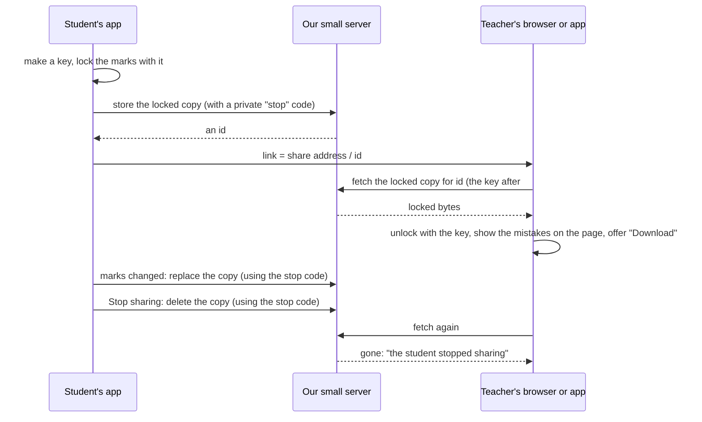
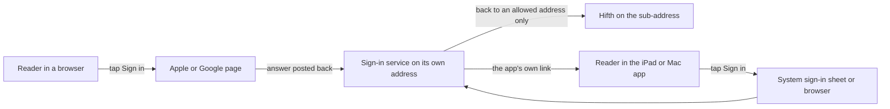

# How could a hafiz send their mistakes to their teacher, and how would they sign in to do it? Researcher B's design

Written 2026-11-08 by researcher B, from the owner's question the same day: "Can we make a web version where we can share files from one user with another / OAuth scope, etc.", "does it need a separate site?", and the wish that a reader's mistakes follow them between their own iPad and Mac through iCloud.
The sources are in [the raw findings](research.md). Researcher A worked on the same question separately; a third agent will compare the two. Nothing is built and no app code was changed.

> [!tip] Short version
> **The question:** how does one reader's own record (mistakes above all; also notes, bookmarks and the record of what they opened) reach another person, such as a teacher, and how do people sign in for it?
> **Recommended, in one line:** start with a "copy for my teacher" file that works today, then build the owner's live teacher link as a **locked link with no account**: our server holds a copy it cannot read, the student can update or switch it off, and the teacher opens it in the app; add accounts only when a teacher needs all their students in one place.
> **Separate site?** Yes, a sub-address of its own (for example `share.bytesofpurpose.com` or `hifth.bytesofpurpose.com`), not a folder of the blog. Pages in a folder of the blog share the blog's storage and cookies, and the blog's host forbids handling sign-ins.
> **Your own iPad and Mac:** treat it apart from sharing with a person. It is the same road you already picked for the usage counts (your own private iCloud for the two Apple apps, a file for the browsers), and it waits on the same signing step.
> **What it changes for a hafiz:** a teacher opens the student's link and sees, on the real page, the verses the student keeps going into another verse on, and drills exactly those. The student decides what goes, and can switch it off.

## Words used here

- **Mistake marks**: what the Mistake pen records: a word the reader got wrong, and where they went instead when they slipped into a look-alike verse. In the code this is the confusion record.
- **The revision record**: which parts of the mus'haf the reader opened, and when, down to the time of night. The privacy check calls it a record of someone's worship.
- **Mus'haf**: the printed Qur'an the app shows page for page.
- **Sign-in permissions** (what developers call OAuth scopes): the list of things a reader agrees to let the app see when they sign in with Apple or Google. The smallest list is "who you are" and "your email".
- **iCloud sharing**: Apple's way for an app to share a record from one person's private iCloud with another Apple account.
- **A locked link**: a link whose data sits on a server in locked form; the key is in the last part of the link (after the `#`), which a browser never sends to any server. Only someone holding the whole link can read it.
- **Sub-address**: a web address of its own under the owner's domain, such as `share.bytesofpurpose.com`, as opposed to a folder such as `blog.bytesofpurpose.com/hifth/`.

## What does it change for a hafiz?

- **For the student:** nothing while reciting. Once in a while, one tap to send their marks to a teacher, and one tap to stop.
- **For the teacher:** the thing a teacher now does by memory or a margin note: "you keep going from this verse into that one." The teacher opens the link, sees the student's mistakes on the page, and drills them. A download button lets the teacher keep a copy (owner, 2026-11-08).
- **What it must never do:** let anyone other than the person the student chose see where that student's memory fails, or let the time-of-night record travel without the student meaning it.

## Why is this being asked now?

The owner asked it today, the paid Apple membership was bought today (which makes iCloud possible for the Apple apps), and the teacher link already has the owner's direction from today: "a live link the student starts and can switch off, and the page it opens has a download button". What was left open is where the shared map lives and who runs it. This note is that.

## What happens if nobody decides?

Nothing breaks. A student can already save their marks to a file and send it; the teacher can load it in their own copy of Hifth, though it merges into the teacher's own marks, which is wrong for a teacher (see option A). The live link does not exist until this is settled.

## What does the app do today?

- **Everything stays on the device.** The app makes no call to any server; the Supabase project holds outside reference data for the build tools only.
- **A file the reader saves** carries bookmarks, notes and mistake marks, and a loaded file merges in. The iPad and Mac apps can now save and open that file (fixed after the usage-count research said they could not).
- **The privacy check** lets mistake marks leave only through that saved file, and the revision record not at all. Every new way out is a name added to its list, on purpose.
- **The rule for one reader's own record** (device now, own cloud copy once there is sign-in) says outright that a record shared between two people "starts its own" decision. So this needs a new decision record; it is not an extension of the old one.

## What do other people do?

Looked, on the web, 2026-11-08 (details and how each was seen are in [the findings](research.md)):

- **Anki** (flashcards): one account syncs your own cards. To give cards to someone else you export a file, and when you do, Anki strips your review history by default: "Anki will assume that you are sharing the deck with other people." Fetched. That is the model for "send the mistakes, not the times".
- **Quran.com**: one account (Google, Facebook, Apple or email) syncs your own notes, progress and collections; sharing with others is only for public reflections. Fetched. A user report says the iOS app synced through iCloud and the website through the account, and they did not meet. Snippet.
- **Tarteel**: public links to a recitation session "to get feedback from your instructor or peers" (2021). Fetched. No private send-to-teacher feature found in the app itself. Snippet.
- **Mofassal** and classroom apps (Maktab, Hifz Tracker): teacher groups, each student's plan, mistake counts, roles of owner, editor and viewer, share a plan by link or invite. All behind accounts. Mofassal fetched; the rest snippets.
- **Apple Notes**: share with invited people or anyone with the link, view only or can change. On iOS 26 and earlier, only with someone who has an Apple device; otherwise "send a copy". Fetched.
- **Google Docs**: "Restricted" or "Anyone with the link", viewer, commenter or editor, switch back at any time, an end date on some accounts. Snippet.

The pattern: your own devices sync through an account or your own cloud; **giving something to another person is either a file or a link with a switch**, and the personal history is stripped unless you ask for it.

## What have we already decided that constrains it?

- **The Qur'an is never paid for**; sharing is the first paid extra named (paid-features). Paid features wait on an App Store release.
- **A reader's record leaves only when it serves them and stays in their control** (storage-model).
- **Mistake marks leave only in a file the reader makes** (confusion-map-export, B). Sharing reopens this; see question ②.
- **The teacher link is live, the student starts it and can switch it off, and the teacher's page has a download button** (owner, 2026-11-08, confusion-points ⑥).
- **Pooling where most readers slip** would use "the same online store the teacher link needs" (confusion-points ⑦). Whatever is built here should not rule that out.
- **The usage counts sync through the owner's own iCloud** for the two Apple apps (usage-sync-own-icloud).
- **The public site carries no Qur'an text and no held commentary.** Nothing here needs either: a share is verse numbers, word positions and the reader's own words.

## What are the options for sending to another person?

| | A. A file sent by hand | B. Apple's iCloud sharing | C. A locked link, no account | D. Our own server, with sign-in |
| --- | --- | --- | --- | --- |
| How | "Copy for my teacher" saves a file without the times; the student sends it by AirDrop, message or email; the teacher opens it in Hifth, which shows it apart from the teacher's own marks | the student's Apple app shares the marks from their private iCloud with the teacher's Apple account, through Apple's own share screen | the student's app locks a copy, puts it on our small server, and gives a link with the key after the `#`; the app re-sends the copy when marks change, and deletes it on "stop sharing"; the teacher opens the link in Hifth | student and teacher each sign in (Apple, Google or an email link); the student adds the teacher; the teacher sees each student who added them |
| Reaches | everyone, today | Apple accounts only; nothing found shows a browser or Android person can open one | everyone with a browser | everyone with a browser |
| Live, and can be switched off? | no: a copy, out of the student's hands once sent | yes, both | yes, both | yes, both |
| Who can see it on the way | whatever carries the file (Apple for AirDrop, the mail provider for email) | Apple, inside the two accounts; counts against the student's iCloud space | our server holds only locked bytes it cannot read; anyone the link is forwarded to can read it | our server, readable by us, protected by per-person rules in the database |
| Pros | almost nothing to build: the saved file exists; no server, no account, no money; fits the existing decision; Anki's model | Apple runs everything; real accounts on both sides; Apple's screen handles invite, stop and permissions; the student can see who has it | does exactly what the owner described; no account for anyone; our server cannot read a student's mistakes; the teacher needs nothing but the link; the same server can later hold the "where most readers slip" pool | a teacher can see all their students on one page; a teacher could write back (a note, a set task); the reader's own devices could ride the same accounts |
| Cons | not live; no way to take it back; a teacher must know to open it as "a student's file", not merge it | needs the paid team's signing (not done yet); leaves out Firefox, Android and anyone without an Apple account; the browsers can't start a share | a forwarded link is a forwarded copy; if the student loses the device that holds the "stop" key, they cannot switch it off unless that key also follows them; needs a small server and a page on an address we fully control (whoever serves the page could read the key) | accounts, a sign-in screen, password-free email, account deletion, a privacy notice; our server can read every student's mistakes; Google sign-in cannot run inside the Apple apps' web view and must open the system browser; the most work by far |
| Implications | adds "copy for my teacher" to what the saved-file part may do; no new door | a new name on the privacy check's list for the Apple apps' bridge; shared records' shape can only grow once live; does not help the browsers, so C or D is still needed for them | the privacy check gains the locked-link sender as a named way out; forces the sub-address question (④); a server with a little upkeep; keeps D possible later | reopens "nothing readable leaves" outright; the sign-in decision (storage-model's "not this year") is made here; the passkey site name, once picked, cannot change |
| Next decision it forces | none | whether non-Apple teachers matter (they do: the owner uses Firefox) | the address (④), and whether the stop key follows the student between devices | which sign-in ways, and the privacy notice |

**Recommended: A now, C for the live teacher link, D only when a teacher needs all their students in one place.**
Why C over D first: it is everything the owner asked for, with no accounts and a server that cannot read anyone's mistakes. Why not B: it does not reach a teacher on Firefox or Android, and the owner's own browser is Firefox.

### How does a locked link work, end to end?

## How would people sign in, if option D is built?

| way in | what the reader agrees to let us see | works in Firefox and Android? | works inside the iPad and Mac apps? | notes |
| --- | --- | --- | --- | --- |
| Sign in with Apple | a stable id; optionally name and email, and the email can be a random forwarding address | yes, by an ordinary web sign-in | yes, through Apple's own sheet (how the answer reaches the page inside the app was not checked) | Apple posts the answer to a server address, so plain files cannot catch it |
| Google | `openid` (who you are), `email`, `profile` (name and picture); nothing else is needed | yes | only by opening the system browser; Google blocks sign-in in embedded web views | |
| An email link | the email address | yes | yes, if the link opens back into the app | Supabase does this out of the box |
| Passkey | nothing beyond the account it is added to | yes | yes | in Supabase it is experimental and cannot create an account, only be added to one; tied forever to the site name it was made on |

The smallest honest list: Apple or an email link to start, with no name asked for. A teacher and a student need only to recognise each other, which the student does by sending the link or adding the teacher's email.

## What about my own iPad and Mac?

Separate from sharing with a person, and it already has an answer for the usage counts: the two Apple apps keep the record in **your own private iCloud database**, which the app's maker cannot see, and Firefox and the phone join by file. Mistake marks, notes and bookmarks could ride the same machinery once it is built.
It waits on the same step as the usage counts: the apps signed by the paid team. And it reopens the same rule: the mistake marks would leave the device for your own iCloud, so it needs your yes (question ①).
Option D's accounts could later carry the same thing to the browsers too; that is not a reason to build D first.

## Does it need a separate site?

**Yes: a sub-address of its own, such as `share.bytesofpurpose.com` (just the sharing pages) or `hifth.bytesofpurpose.com` (the whole app), not a folder of the blog.** The server part itself would live at Supabase's own address either way.

- **A folder of the blog shares everything with the blog.** A browser walls off storage by address (scheme, host and port), not by folder: the app at `blog.bytesofpurpose.com/hifth/` already shares its stored data with every page of the blog. Cookies do not stop at a folder either. A sign-in or a link key handled there could be read by any script anywhere on the blog. (MDN and the cookie standard, fetched.)
- **The locked link's key is only as safe as the page that opens it.** The page reads the key after the `#`; whoever serves that page could read it too. It should be served from an address that holds nothing else.
- **The blog's host forbids it.** GitHub Pages "shouldn't be used for sensitive transactions like sending passwords", and not for a paid service. (Fetched.)
- **Sign in with Apple posts its answer to a server**, which plain files cannot catch; Supabase catches it on its own address and sends the reader back only to addresses on an allow list.
- **Passkeys are tied to one site name forever.** Choosing `hifth.…` or `share.…` keeps them off the blog and the blog off them.
- **The public build stays as it is.** The pages on the blog stay plain files with no reader data and no Qur'an text; the sharing pages need neither text nor commentary, only verse numbers and the reader's own words.
- **The Apple apps' links** carry on: a share link can open the app (once the app links work under the paid team) or the web page.

## What else could be considered, and why is it not an option here?

- **A plain link with the marks written into it** (no server at all). A full map may be too long for a link, the student cannot switch it off, and anyone who sees the link sees the mistakes. It is a smaller A, not a live link.
- **Apple's iCloud web library in the browser**, so browsers could join option B. Not shown to work in Firefox; the recent forum reports of failure have no answers (from the usage-count research).
- **A shared folder in iCloud Drive, Dropbox or Google Drive.** Works for the student's own devices; for a teacher it means both use the same company's drive. A file (A) is simpler.
- **An email sent from the app.** That is A with a different carrier.

## What would change the answer?

- **A teacher wanting a page of all their students, or to set work back:** D becomes worth its cost.
- **Every teacher who matters having an Apple account:** B becomes the cheapest live option.
- **The owner deciding no readable copy should ever sit on a server we run, even locked:** stop at A and B.
- **The App Store question going the wrong way:** a paid share would have to be sold on the web, or not at all.

## What is this not settling?

- The exact fields of the shared copy. Each record's own decision owns that.
- Pooling where most readers slip (confusion-points ⑦), except that C's server could serve it.
- Price.

## Open questions, and what would answer each

### ① May my mistakes and notes follow me between my own iPad and Mac through my own iCloud? · **answered**

Merged into question ① on [the consolidated page](../../../design/sharing-between-readers.md#open-questions-and-what-would-answer-each), which is the one to act on; the text below is kept as the record.

The same road you picked for the usage counts, carrying more personal records. It means the mistake marks leave the device for your own iCloud, which the privacy check must be told about. **What would answer it:** your yes or no; then it is built with the usage-count sync once the apps are signed by the paid team.

### ② Which way should a student's mistakes first reach a teacher: a file, a locked link, or a signed-in account? · **answered**

Merged into question ③ on [the consolidated page](../../../design/sharing-between-readers.md#open-questions-and-what-would-answer-each), which is the one to act on; the text below is kept as the record.

The table above; recommended A now and C for the live link. Each one adds a named way out to the privacy check, which only you can allow. **What would answer it:** your pick, written as a new decision record (sharing between two people starts its own record), with a rough build of the teacher's view so the choice is made by hand.

### ③ Does the record of when I read ever go with a share, or only my mistakes and notes? · **answered**

Merged into question ④ on [the consolidated page](../../../design/sharing-between-readers.md#open-questions-and-what-would-answer-each), which is the one to act on; the text below is kept as the record.

The time-of-night record is the most private thing the app keeps. Anki strips review history when sharing with someone else. **What would answer it:** your call; the suggestion is never by default, and only as a separate tick the student sees each time.

### ④ Which web address would the sharing pages live on, and should the app itself move off the blog's address? · **answered**

Merged into question ⑧ on [the consolidated page](../../../design/sharing-between-readers.md#open-questions-and-what-would-answer-each), which is the one to act on; the text below is kept as the record.

`share.bytesofpurpose.com` for the sharing pages only, or `hifth.bytesofpurpose.com` for the whole app. Moving the whole app would leave readers' stored marks behind at the old address unless they carry a file across. **What would answer it:** your choice of name and a DNS entry you add; the agent then writes up the move.

### ⑤ Is sending a share a paid extra, and is opening one always free? · **answered**

Merged into question ⑩ on [the consolidated page](../../../design/sharing-between-readers.md#open-questions-and-what-would-answer-each), which is the one to act on; the text below is kept as the record.

Paid features wait on the list of what is paid. A teacher who has to pay to see a student's mistakes would mostly not look. **What would answer it:** the paid-features list; a purchase on the web would not need the App Store, which is worth putting on that list.

### ⑥ Can a teacher with no Apple device open an iCloud share at all? · **answered**

Merged into question ⑪ on [the consolidated page](../../../design/sharing-between-readers.md#open-questions-and-what-would-answer-each), which is the one to act on; the text below is kept as the record.

Nothing found says yes; one report of a browser attempt failed. **What would answer it:** a test share from the Apple app opened in Firefox and on an Android phone, once the apps are signed by the paid team.

### ⑦ Can Sign in with Apple and an email link work inside the iPad and Mac apps? · **answered**

Merged into question ⑨ on [the consolidated page](../../../design/sharing-between-readers.md#open-questions-and-what-would-answer-each), which is the one to act on; the text below is kept as the record.

Google blocks sign-in inside an app's web view; Apple has its own sheet, but how its answer reaches the page inside the app was not checked. Only needed if D is built. **What would answer it:** a throwaway sign-in on a test Supabase project, tried in both apps.

### ⑧ What does the teacher see when they open the link: the student's mistakes on the real page, or a list? · **answered**

Merged into question ⑫ on [the consolidated page](../../../design/sharing-between-readers.md#open-questions-and-what-would-answer-each), which is the one to act on; the text below is kept as the record.

The page is the stronger picture for the pitch; a list is quicker to scan across a whole juz. **What would answer it:** build both roughly, open them on an iPad, and keep the loser as a setting.
