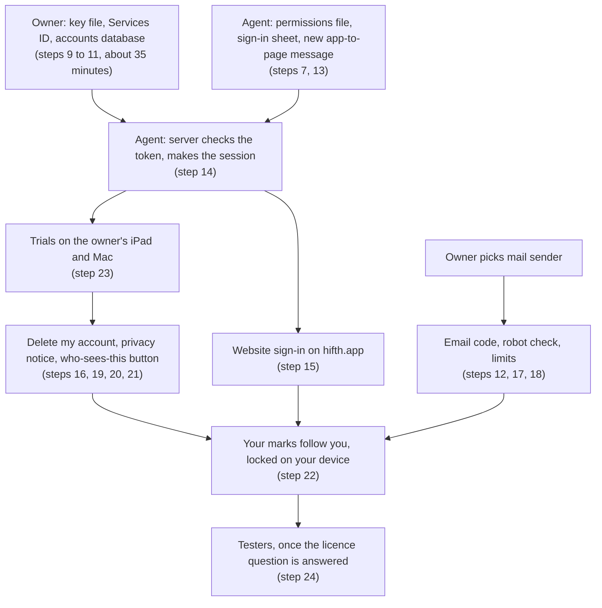
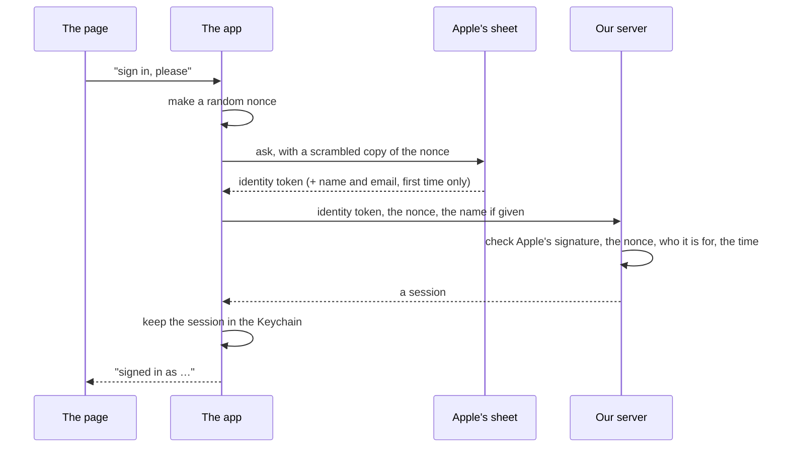
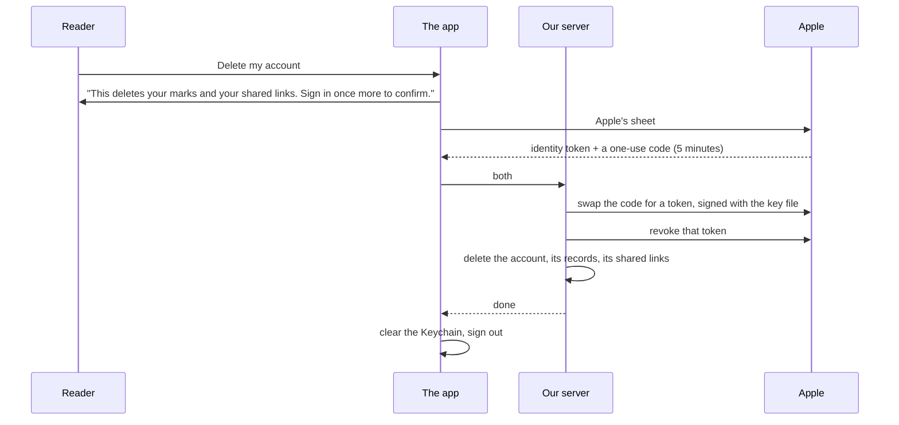

# How close are we to Sign in with Apple, and how should sign-in be built for testers? (researcher A)

> [!tip] The short version
> **Where we are.** The paid Apple membership is active. The app's Apple ID has Sign in with Apple ticked, and the iPad build is signed with the paid team. hifth.app already runs small server functions on Cloudflare. No sign-in code exists yet: no sign-in button, no message between the page and the app for it, no server that checks a sign-in, and no accounts store.
>
> **What is left.** 6 steps are done and 18 are left (the table below counts them). Five of the 18 are the owner's, in Xcode and the Apple and Cloudflare dashboards, each between five minutes and an hour. The rest is code, about two to three weeks of agent work. Testers stay blocked on the licence question whatever we build.
>
> **The recommendation in one line.** In the iPad and Mac apps, use Apple's own sign-in sheet and pass the result to the page. On hifth.app, send the browser to Apple and back as a full page, which works in Firefox. Check every sign-in on one small server of our own on Cloudflare, next to the shared copies and the mailing list. Offer a six-digit email code as the second way in. Make the first thing sign-in unlocks **your own marks following you to Firefox and to a phone**, locked on your device before they leave it.

The raw findings, with every source and how it was seen, are in [research.md](research.md). This page is the design. It does not change any setting anywhere, and it adds no decision row; the checker merges this with researcher B's page first.

## Words used here

- **Hafiz** (plural *huffaz*): someone who has memorised the Qur'an, or is memorising it, and revises it daily.
- **Revision record**: the marks a reader leaves while revising (a mistake, a hesitation, a verse to come back to). Today it never leaves the device except by ways the privacy check names.
- **Sign-in sheet**: the panel Apple draws over the app ("Continue with Apple") with Face ID or Touch ID. Only the app can show it.
- **Identity token**: a short note Apple signs and hands back after a sign-in. It says "this is person X, signed in to app Y, just now". Our server checks Apple's signature on it and then trusts what it says. It lasts about ten minutes (measured by others; Apple gives no number).
- **Nonce**: a random one-off word we make up before asking Apple. Apple hands back whatever we send, inside the identity token. If the word in the token is the one we just made, the token was made for this sign-in and is not a stolen old one being replayed.
- **Account id**: the fixed id Apple gives a person for our team's apps. Apple says it is the same in the app and on the website. One forum report says otherwise, so we test it (see the last section).
- **Services ID**: the name Apple gives our website for sign-in, the way the app has its bundle id.
- **Return address**: the hifth.app page Apple sends the browser back to after a website sign-in. It must be a real https address.
- **Key file**: a private key Apple lets us download once (a `.p8` file). With it our server signs short notes that prove to Apple it is us.
- **Client secret**: one of those short notes. Apple accepts it for up to six months; we can sign a fresh one for each call instead.
- **Revoke**: tell Apple to cut the link between a person and our app, so the app no longer appears in their Apple settings. Apple expects it when someone deletes their account.
- **Hidden email**: the `@privaterelay.appleid.com` address Apple gives us when a person chooses "Hide My Email". Mail to it is forwarded, but only from senders we registered.
- **Session**: after sign-in, a long random string our server hands to the device. The device shows it with each request, so the person does not sign in again every time.
- **Keychain**: Apple's locked store for secrets on each device.
- **Cloudflare's free database (D1)**: the small database next to hifth.app. Sharing plan ⑥ already chose it for shared copies.
- **Supabase**: the hosted database the project already uses for the held copy of outside Qur'an data and for the mailing list.

## What would signing in let a hafiz do that they cannot do today?

Today everything a reader does stays on the one device. The iCloud plan (see [carrying your records between iPad and Mac](../../../design/icloud-sync.md)) would carry records between the owner's own Apple devices, through the reader's private iCloud, with no account of ours. So sign-in is only worth building for what iCloud cannot do:

| What sign-in adds | Without sign-in | With sign-in |
| --- | --- | --- |
| Your marks in **Firefox**, on a Windows computer, or on an Android phone | Only by saving and opening a file by hand | They are there when you sign in |
| A new phone, or a family computer | Start again, or carry a file | Sign in and carry on |
| Switch off a link you gave a teacher, **from any device** | Only from the device that made it | From anywhere you are signed in |
| Sharing between a student and a teacher (sharing plan ⑨) | Locked links only | Accounts each side can manage |
| A tester reports a fault with their marks attached | They describe it | We can ask them to send that one record, by a button they press |

**The smallest first thing worth building** is the top row: one file per account, holding your own revision record, written all at once each time and locked on your device before it leaves. The server stores a sealed box it cannot open. It is the same shape the sharing research called "your own cloud file". Switching off a shared link from anywhere comes next, because it uses the same account and the same server. Teacher sharing waits on sharing plan ③.

What it changes for a hafiz: revising on the iPad in the morning and on the family laptop in Firefox at night becomes one revision, not two. That is the habit sign-in earns its place with.

## How close are we?

"Owner" means a few clicks in a dashboard, which no agent may do for this research. "Agent" means code in this repository, tested on the owner's own devices. Efforts are rough.

| # | Step | Done or left | Whose turn | Rough effort |
| --- | --- | --- | --- | --- |
| 1 | Paid Apple Developer membership (individual, yearly, since 2026-11-08) | done | — | — |
| 2 | The app's Apple ID registered with Sign in with Apple ticked (2026-11-09) | done | — | — |
| 3 | iPad build signed with the paid team (2026-11-10) | done | — | — |
| 4 | hifth.app on Cloudflare, already running small server functions for the mailing list | done | — | — |
| 5 | Cloudflare's free database chosen for shared copies (sharing plan ⑥, 2026-11-09) | done | — | — |
| 6 | A privacy check that refuses any way off the device it does not name | done | — | — |
| 7 | Give the iPad and iPhone build a permissions file asking for Sign in with Apple, and add the same line to the Mac's empty one | left | agent | an hour |
| 8 | Sign the Mac build with the paid team | left | owner in Xcode, then agent | an hour |
| 9 | Make the Sign in with Apple key file and store it in Cloudflare's secrets. **Needed even if nobody ever signs in on the website**, because deleting an account means revoking, and revoking needs it | left | owner in the Apple and Cloudflare dashboards | 15 minutes |
| 10 | Make the website's Services ID with its return addresses on hifth.app | left | owner in the Apple dashboard | 15 minutes |
| 11 | Make an accounts database on Cloudflare | left | owner in the Cloudflare dashboard, or the agent with the owner's yes | 5 minutes |
| 12 | Register the mail sender with Apple, so mail reaches hidden emails (its sending checks must match exactly) | left | owner in the Apple dashboard and the domain's DNS; waits on the mail sender choice | 30 minutes |
| 13 | The sign-in button in the app: Apple's sheet, the nonce, and a new message from the app to the page carrying the result | left | agent | 1 to 2 days |
| 14 | The server: check Apple's identity token, make an account, hand out a session, sign out, and take Apple's notices that a reader has left | left | agent | 2 days |
| 15 | Website sign-in on hifth.app, as a full trip to Apple and back (not a popup) | left | agent | 1 to 2 days |
| 16 | Delete my account, from inside the app: ask Apple once more, revoke, delete everything | left | agent | 1 day |
| 17 | A second way in: a six-digit code by email | left | agent, after the owner picks the mail sender (an open decision already) | 1 to 2 days |
| 18 | Slow down guessing: limits per account and per address, Cloudflare's free robot check on the email form | left | agent | half a day |
| 19 | A button that says what leaves the device and who can see it, and a page to see and take back what you sent (the "reader decides who sees their data" tenet) | left | agent | 1 day |
| 20 | Name the new way off the device in the privacy check, so nothing else can sneak out with it | left | agent | an hour |
| 21 | A privacy notice, linked in the app and on the site, saying what is kept, for how long, and how to delete it | left | agent drafts, owner approves | half a day |
| 22 | The first thing it unlocks: your own marks, locked on your device, following you to Firefox and the phone | left | agent | 3 to 4 days |
| 23 | Four quick trials on the owner's devices (see the last section) | left | owner holds the devices, agent runs them | an hour |
| 24 | Testers through TestFlight | left | **blocked on the licence question**, not on sign-in | — |

**6 done, 18 left.** Of the 18, five are short dashboard steps for the owner (8, 9, 10, 11, 12), one is a trial on the owner's devices (23), one is blocked elsewhere (24), and eleven are code.

### What can be built and tried now, without testers?

All of steps 7, 13, 14, 16, 19, 20 and 22 run on the owner's own iPad with a development build. Step 16 also needs the key file from step 9, because revoking is signed with it. Apple's sheet appears for any build signed with the paid team that carries the permission; no App Store listing is needed. The server runs on the laptop against a local copy of the database. Website sign-in (step 15) needs one real https address on hifth.app registered as a return address. A preview address works if it is registered, and each one counts toward the ten Apple allows.

## How should the iPad and Mac apps sign in?

The app shows its page from its own address inside the app, not from an https site. That one fact decides most of this.

| | **Apple's own sheet, result passed to the page** (recommended) | Website sign-in in a browser panel the app opens | Apple's web button inside the app's page |
| --- | --- | --- | --- |
| What happens | The page asks the app; the app shows Apple's sheet; Face ID; the app hands the identity token to our server and the session to the page | The app opens a browser panel at hifth.app; the person signs in to Apple there; the panel closes and returns to the app | The page draws Apple's web button itself |
| Pros | Apple's own look; Face ID; no password typing; Apple's reviewers expect it | Same code as the website | No app code |
| Cons | New app code and a new app-to-page message | Asks for the Apple Account password even on the person's own device; matching an https return needs iPadOS 17.4 and macOS 14.4 | Apple's return address must be https, and our page is not; an Apple engineer says use the app's sheet or a browser panel instead; it broke inside app pages on iOS 17.1 |
| Implications | The server must accept two names for us (the app and the website) | Two sign-in paths to maintain on Apple devices | Ruled out |
| For a hafiz | One look at the iPad and you are in | A password prompt mid-revision | Would not work |

Details the code has to get right, each from Apple's pages unless marked:

- **The name arrives once.** Apple hands over the name and email only on the very first sign-in. The app must send them to the server straight away, and the server must keep them. If that first save fails, the name is gone until the person removes the app in their Apple settings.
- **The nonce.** Send Apple a scrambled copy (a SHA-256 hash) and keep the original to send to our server. Apple does not require the scrambling; it is the common convention, and what matters is that the app and the server agree.
- **Two names for us.** In the app, Apple's token names the app. On the website, it names the Services ID. The server accepts both and nothing else.
- **Still signed in?** At each launch the app asks Apple, on the device, whether the person is still signed in. It is local and cheap. If the person stopped using Sign in with Apple for our app, sign them out.
- **The button.** Apple's own button, one of its three wordings, no smaller than any other sign-in button. Apple's reviewers check custom-drawn ones.

## How should hifth.app sign in, including in Firefox?

| | **A full trip to Apple and back** (recommended) | Apple's popup window |
| --- | --- | --- |
| What happens | The browser leaves hifth.app for Apple's page, then Apple posts the result back to our return address | A small Apple window opens over the page and passes the result back |
| Pros | No cross-window messages to fail; Firefox's tracking protection has less to block | The page does not reload |
| Cons | The page reloads; the post comes from Apple's site, so the browser does not send our normal cookies with it | Forum reports of silent failure in Firefox, and a blank window in all browsers in May 2026 |
| Implications | The server keeps a short-lived record of each sign-in it started, matched by a random value, instead of relying on a normal cookie | — |
| For a hafiz | One extra page load, once | A window that may do nothing |

The cookie problem is real and has caught a popular library (see below). The fix is small: when the server starts a sign-in, it stores the random value, with a five-minute life, in its own database, and checks the posted value against that. No cookie is needed for the return trip.

The client secret can be signed fresh, minutes long, for each call. So no one has to remember to renew a six-month one. The cost is that the key file sits in Cloudflare's secrets, the same way the mailing list's keys already do.

## Where should accounts live?

The money is not what decides this. Supabase's free projects pause after a week without use, and a timer to keep the project awake is already planned. Cloudflare's free database does not pause. All four options are free for a few dozen testers. What decides it is what each one does for the reader and how much can go wrong.

| | **Our own small server on Cloudflare, checking Apple's token ourselves** (recommended) | The same place, with a ready-made sign-in library | A new Supabase project just for readers | Apple's iCloud only, no accounts of ours |
| --- | --- | --- | --- | --- |
| What it is | About 300 lines on Cloudflare Functions, using a small, well-known library for checking signed notes, plus tables in the free database | Better Auth, which since February 2026 takes the free database directly and has Apple, email-link and passkey add-ons | Supabase's sign-in service: the app hands it Apple's token; it makes the account and the session | The iCloud plan, extended: records go to each reader's private iCloud; CloudKit's web version for the browser |
| Pros | Everything next to the shared copies and the mailing list; every line is ours to read; no hidden behaviour; the "reader decides" button and the privacy check sit in our own code | Less code; sessions and add-ons come built | Sign-in, sessions and email codes are done and widely used; the app's sign-in needs no key file | No server and no accounts to secure; nothing pauses; Apple holds the records |
| Cons | We own sessions, guessing limits and email codes; a fault is ours | Its Apple website sign-in had exactly the cookie bug above, closed and reportedly reverted, now locked; its add-ons are not shown tested on the free database; on our app's address it needs its "no cookie" add-on, which it says is for APIs | A second home for reader data, away from ⑥; the existing project must never hold accounts, so this is a new one, and a second free project may need the old one deleted first (an owner check); Supabase's public key ships in every app, and only rules on each table keep readers apart; a summary of a security scan (the scan itself was not read, so unconfirmed) says 16,000 Supabase databases were readable because those rules were missing | Firefox, Windows and Android are the very readers sign-in is for, and Apple's web sign-in there is shaky; sources disagree on whether the browser can read locked fields; a reset iCloud Keychain loses locked records for good |
| Implications | Commits us to writing the security parts carefully, with tests for each; sharing plan ⑨ can be built on the same tables | Ties our session shape to the library's next release | Splits reader data across two providers; the deletion step must delete in both | Answers only the Apple-devices half; the iCloud plan stays the right answer for that half anyway |
| For a hafiz | Signs in once; their marks live beside their shared links | The same, if the library behaves | The same; their data sits with a second company | Seamless on iPad and Mac, little help on the laptop in Firefox |

**Why the first one.** The work that makes sign-in "proper" (the who-sees-this button, the privacy check's named way out, deletion that really deletes, locking records on the device) is ours to write in every option. A library saves us the easy part, the session table, and brings a bug in the hard part, the website return trip. The checking itself is about forty lines with a library made for it: fetch Apple's public keys, check the signature, the nonce, who it is for, and the time.

**What we would be careful of in our own code**, each with a test:

- never accept a request whose origin is "null", which the app's page has been seen to send;
- give the same answer whether an email is known or not;
- count wrong email codes per account and per address, and lock for a while after a few;
- store only a scrambled copy of each session, so a leaked table cannot sign anyone in;
- end a session on sign-out on the server, not only on the device.

## How should the app's page hold the session?

| | **The app keeps it and makes the calls** (recommended) | The page keeps it in its own storage | A cookie |
| --- | --- | --- | --- |
| How | Session in the Keychain; the page asks the app ("send this"), the app's own code sends it | The page stores the session and calls the server itself | The server sets a cookie |
| Pros | The page never sees the session; no cross-site rules to fight; the Keychain survives app updates | Same code as the website | Normal for websites |
| Cons | One more message type between page and app | Anything that runs in the page can read it; our page's origin is odd ("null" has been seen) | Our page is not on our site, so the browser treats every call as cross-site |
| For a hafiz | Stays signed in on the iPad for months; nothing to retype | The same, with more ways for it to leak | Signed out at random |

On hifth.app itself, a normal secure cookie is right, because there the page is on our own site.

Sessions last a long time, because a hafiz revises daily on one iPad and should not sign in again each week. Suggested: a session that renews itself each time it is used and ends after 60 days unused, with a fresh Apple check before deleting the account or switching off a link.

## How should "delete my account" work?

Apple's review rules say deletion starts inside the app, deletes everything, and should revoke the link with Apple. Apple's own technote gives two ways. We pick the one that keeps no Apple tokens at all.

| | **Ask Apple once more at deletion, then revoke at once** (recommended) | Keep Apple's long-lived token from the first sign-in |
| --- | --- | --- |
| Pros | No Apple token sits in our database; the fresh check also proves it is really them | Deletion needs no extra step |
| Cons | One more Face ID at deletion | A long-lived token to guard for every reader |
| Implications | The server needs the key file only at that moment | The server needs the key file at every sign-in too |

A reader who signed in on hifth.app does the same, but through the trip to Apple and back instead of the sheet. The server then swaps the code under the website's name, with a client secret made for the website, because Apple wants one secret per name. A reader who only ever used the email code has no Apple link to revoke, so deletion just asks for a fresh code and deletes.

If the swap fails (the code was used, or Apple is down), the server still deletes everything and tells the reader how to remove the app from their Apple settings themselves. Apple's technote says exactly that.

Apple can also tell our server when someone stops using Sign in with Apple, deletes their Apple Account, or switches off their hidden email. One https address on hifth.app handles all four. It is worth adding with the server, because it is how we hear that a reader is gone.

## What is the second way in?

Everyone on an Android phone, and anyone who does not want Apple, needs another way.

| | **A six-digit code by email** (recommended) | A one-time link by email | A passkey | Google |
| --- | --- | --- | --- | --- |
| Pros | Works in every browser and in the app's page; no link for a mail scanner to burn; nothing to remember | One tap | No email at all; Face ID or a fingerprint | Many readers have one |
| Cons | Needs our own mail sender (an open decision already) | Workplace and school mail scanners open the link first and use it up; a link must reopen the app, which needs setup we have not sourced | In the app's page, passkeys work only for the app's own linked domain, and our page's address probably breaks them (untested); Supabase's version is experimental and cannot make an account | Google refuses sign-in inside an app's page; adding it pulls in Apple's equal-option rule (already met by Apple) |
| For a hafiz | Type six digits once a month | Tap, unless the school's mail filter got there first | Fastest, once it works | Familiar |

Passkeys are the better second way in a year from now. They need a test first, and they can come after the email code, not instead of it.

## What else does proper sign-in for testers need, beyond the button?

- **A privacy notice**, linked inside the app and on the site, and in App Store Connect. It says what is kept, who else sees it, how long, and how to delete. Apple requires it.
- **Revision records are worship records.** A record of which verses someone keeps getting wrong is very likely data about religious practice, which European data law treats as a special kind needing explicit consent for a stated purpose. This is a reading of the law, not legal advice. In practice: the "who sees this" button asks, by name, before anything leaves the device.
- **Locked on the device before it leaves.** The first synced file is sealed on the device with a key the server never holds. In the apps, Apple's own locking code does it. On hifth.app the browser's built-in locking does it. Whether the app's page can use the browser's version is untested, so the apps do it in Swift. The key comes from a recovery code the reader saves once (kept in their Keychain on Apple devices, and typed once in Firefox). The honest cost: lose the code, lose the synced copy, as with Apple's own Advanced Data Protection. The marks on the device are never at risk. If that cost is too high for the first testers, the fallback is the server's own encryption with a clear note that we could read it, and that is a choice the owner should make with eyes open.
- **Deletion and sign-out** as above, both from inside the app.
- **Limits** on guessing and on email sends, and the free robot check on the email form.
- **The App Store privacy label** will need "Sensitive Info", "Other User Content", "User ID" and "Email Address". It can be changed without a new build.
- **Mail to hidden emails** must come from the registered sender, or it bounces.

## How do other Qur'an and hifz apps do accounts?

| App | Ways in | Can you use it without one? |
| --- | --- | --- |
| [Quran.com](https://quran.com/product-updates/centralized-accounts-across-quran-foundation) | Google, Facebook, Apple, email; one account across its apps since November 2025 | not stated on the page read |
| [Tarteel](https://support.tarteel.ai/en/articles/12168720-how-to-create-a-tarteel-account) | email and password, Apple, Google; mistake history is paid | not stated |
| [Muslim Pro](https://support.muslimpro.com/hc/en-us/articles/4648775233549-Setting-Up-A-Muslim-Pro-Profile) | email, Google, Apple | yes, but nothing is kept |
| [Mofassal](https://apps.apple.com/us/app/mofassal-quran-hifz-review/id1584188020) | not stated; guest first; teacher groups with roles | yes |
| [Hamil Al Quran](https://apps.apple.com/app/id6749209998) | not stated; teachers link students by code | yes, "works fully without an account" |

The pattern: the apps that hafiz-teachers use start without an account and add one for sync and teachers. That matches starting with "your marks follow you" and keeping every account optional. Did not look: Quran Companion, Hifz Planner, Quranic, Ayah, Itqan, Qaloon, Tarteel's teacher product.

## What would change the answer?

Four quick trials on the owner's devices settle the things no page could. Each one is a short test, and the answer could move a recommendation.

| Trial | If yes | If no |
| --- | --- | --- |
| Does one person get the same account id in the app and on hifth.app? | One account, as designed | Link the two by email the first time, or ask the reader to sign in both ways once |
| What origin does the app's page send, and can it use the browser's locking code? | Locking could live in shared page code | As planned: the app keeps the session and locks in Swift |
| Only if accounts go to a new Supabase project: is Apple's one-use code still usable after Supabase has taken the identity token? (Under the recommended server this never comes up, because our server checks the token itself and keeps the code.) | Deletion with Supabase works as drawn | With Supabase, deletion falls back to "deleted, and here is how to remove us from your Apple settings" |
| Does website sign-in work before the app is in the App Store? (One Apple page says it needs an existing app there; another does not) | Build the website sign-in now | The website sign-in waits for the first App Store release; the app goes first |

Other things that would change it:

- If sharing plan ③ lands on sending marks through a server, the accounts tables grow to hold teachers; the home stays the same.
- If the licence question keeps testers away for months, the website sign-in can wait, and the iCloud plan covers the owner's own devices meanwhile.
- If the owner would rather not write the security parts ourselves, a new Supabase project is the next best. Never the existing one.
- If Better Auth fixes and keeps fixed its website return-trip bug, the library option closes most of the gap.

**Something to check, not a confirmed fault.** The checked-in Supabase settings say its data door is off, but the mailing-list code calls that door. The live project was not looked at. Either the settings file is out of date, or the list goes through a door the settings do not show. This matters before anything else is added to that project.

## What is this not settling?

- Which way a student's marks first reach a teacher (sharing plan ③).
- Which company sends the email (the mail sender decision already open).
- The exact design of the recovery code and how the locked file is laid out.
- Whether to add Google, or passkeys, later.
- Any legal advice on European data law. The reading here is a starting point for someone qualified.
- Anything about the pitch build; this is for the shipped app and its testers.
