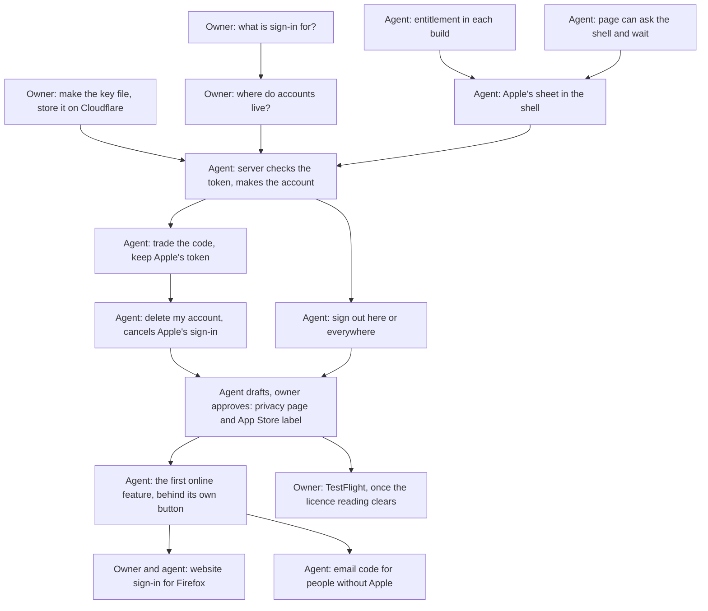
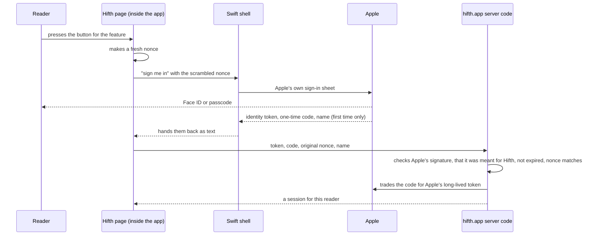

# How close is Hifth to letting a reader sign in with Apple, and how should sign-in be built? Design, researcher B

Written 2026-11-15 by researcher B, working apart from researcher A, whose files were not read. The sources behind every claim are in [the raw findings](research.md). No app code and no Apple, Supabase or Cloudflare setting was changed.

> [!tip] The short version
> - **Where we are.** The Apple account side is mostly ready. The paid membership is active, the app's Apple id has Sign in with Apple turned on, and the iPad app is signed with the paid team. **None of the code exists yet.** No build carries the Sign in with Apple permission. The page inside the app cannot yet ask the shell a question and wait for the answer. And there is no server that checks who someone is or keeps an account.
> - **What is left.** 14 of 20 steps are left, and 3 more sit in Apple's developer site where this research could not see; the owner should confirm them. The rest is two decisions for the owner, a few short dashboard steps, and roughly two to three weeks of code. The full list is [the table below](#how-close-are-we-step-by-step).
> - **The finding that matters most.** Today there is nothing online for a signed-in reader to use. Testers do not need an account: TestFlight brings its own invitations and its own feedback button. So the first decision is what sign-in unlocks, not how the button works.
> - **Recommendation, in one line.** Build the plumbing now and show it to no one. When the first online feature is picked, sign readers in with Apple's own sheet in the apps, checked by a small piece of code on hifth.app that runs on Cloudflare with its free database. Then add a typed email code for readers in Firefox or without an Apple account.

## What do these words mean?

- **Hafiz** (plural *huffaz*): someone who has memorised the Qur'an, or is memorising it. The app is for them.
- **Shell**: the Swift app on the iPad, iPhone and Mac. It shows Hifth's web page inside itself.
- **Bridge**: the channel between the page and the shell. Today it carries messages one way, from the page to the shell.
- **Identity token**: a short signed note from Apple that says "this is Apple user X, signed in just now, for this app". Our server checks Apple's signature on it before believing it. It lasts about ten minutes; that figure rests on search snippets only.
- **Authorization code**: a one-time ticket Apple hands over with the identity token. It lasts five minutes. Our server can trade it with Apple for a long-lived token, which is needed later to cancel the person's Apple sign-in when they delete their account.
- **Nonce**: a random one-time value the page makes for each sign-in. The app sends Apple a scrambled form of it (its SHA-256 hash), and Apple writes that into the identity token. The page gives our server the original value. If the two match, a token stolen from somewhere else cannot be replayed.
- **Services ID**: the name Apple gives a website that uses Sign in with Apple. The website version needs one; the app versions do not.
- **Key file**: a private key made in Apple's developer site (a `.p8` file). It is shown for download only once. Our server uses it to prove to Apple that it really is Hifth when trading or cancelling tokens.
- **Client secret**: a short signed note made with that key. Apple accepts one for at most six months. A hosted service needs a new one pasted in every six months; our own code can make a fresh one each time instead.
- **Private relay email**: the address Apple gives an app when a person picks "Hide My Email". Mail sent to it reaches their real inbox only if the sending address has been registered with Apple first.
- **Entitlement**: a line in the app's signed build that says "this app may use Sign in with Apple". Without it the sheet will not open.
- **Cloudflare Functions and D1**: small pieces of server code that hifth.app already runs (for the notify list), and Cloudflare's free database that sits next to them.
- **Supabase**: a hosted database with sign-in built in. The project already has one Supabase store, which holds the outside library and the notify list.

## What does sign-in change for a hafiz?

**For reading and revising: nothing, and it must stay that way.** Every Qur'an app looked at lets people read with no account. Hifth already keeps a reader's marks and revision record on their own device, and on their own Apple devices through their own iCloud. A sign-in wall before the mus'haf (the printed page) would cost a hafiz the thing they came for.

**What sign-in can add is one thing: something of theirs that lives off their own devices, on purpose.** Three examples:

- their marks and record following them to Firefox or an Android phone, which iCloud cannot reach;
- a teacher link they start and can switch off;
- one day, a paid extra.

Each of those is a new way for the record to leave the device. That record shows where a person's memory slips in the Qur'an, so it is close to their worship. Under the project's privacy rule, each new way out is its own button, and the button says what goes and to whom.

**The risk to weigh.** An account means we hold the person's email, or an Apple relay address, and a user number. If the practice record reaches our server in a form we can read, the App Store label has to declare it. It may even count as "sensitive", a category Apple's own page says covers religious beliefs. So the safest first feature sends nothing about their memorisation that we can read, or it says plainly that we can.

## What is the smallest first thing worth signing in for?

**Researcher B's pick: a copy of the reader's own saved file on hifth.app, so their marks and record follow them to Firefox or an Android phone.** It is one button: "Keep a copy of my marks on hifth.app". The reader can also open that copy from another browser, or delete it.

Why this one:

- **It is already the plan.** The storage decision names it as what happens "on the day there is sign-in": the reader's own cloud copy, written all at once.
- **It fills the one gap iCloud leaves.** Own-device sync already covers the iPad, iPhone and Mac, but it cannot reach Firefox or Android. Today those readers carry a file by hand.
- **It involves one reader and one record.** Nobody else sees it, so it raises none of the consent questions that sharing between people raises.
- **The file already exists.** The app can already write it and read it back.

What it costs:

- It is a new way for the record to leave the device. So it is added to the privacy check on purpose, and the button says what goes and to whom.
- In its first form we could read the copy. The button has to say that plainly, unless it is locked with a key kept on the reader's devices (see [what this is not settling](#what-is-this-not-settling)).

**The runner-up is the teacher link.** It waits on which way sharing goes, and it might need no account at all.

**If the owner wants neither yet, the honest answer is "not yet":** build the hidden plumbing and stop there.

## Why is this being asked now?

On 2026-11-15 the owner said: "i want to do proper auth, especially if we open this up for testers ... how close are we to adding sign in with apple to use the online experience?" Two things changed that week:

- the paid Apple membership arrived on 2026-11-08;
- the iPad was signed with the paid team on 2026-11-10.

Sign in with Apple needs both.

**What we have already decided that constrains it.**

- The storage decision says that on the day there is sign-in, the reader's own record goes to their own cloud copy, written all at once. It also ties when sign-in comes to the licensing question, and says "not this year".
- The sharing page says there is no Sign in button with nothing behind it. It also says the apps use Apple's own sheet, never a web sign-in page inside the app.
- The owner chose Cloudflare's free database for shared things on 2026-11-09.

**What happens if nobody decides.** Nothing breaks. Testers can still be invited through TestFlight once the licence reading clears the upload, and they can send feedback through TestFlight's own button. Own-device sync goes through iCloud with no account. The cost of waiting is only that the online features stay unbuilt: the teacher link, the record in Firefox and the shared look-alike counts.

## How close are we, step by step?

"Not checked" means the step lives in a dashboard this research could not see. The owner should confirm it.

| # | Step | State | Whose turn | Rough effort |
| --- | --- | --- | --- | --- |
| 1 | Paid Apple Developer membership | **done** (2026-11-08) | owner | — |
| 2 | App's Apple id with Sign in with Apple, Associated Domains, iCloud and Push turned on | **done** (2026-11-09) | owner, Apple site | — |
| 3 | iPad app signed with the paid team | **done** (2026-11-10) | owner and agent | — |
| 4 | Decide what sign-in is for: the first online feature | left | owner, a decision | one conversation |
| 5 | Decide where accounts live (Cloudflare's database, a new Supabase project, or Firebase) | left | owner, a decision | one conversation |
| 6 | Add the Sign in with Apple entitlement to the iPad and iPhone build (it has no entitlements file today) and to the Mac's (empty today) | left | agent, code | an hour |
| 7 | Sign the Mac app with the paid team instead of ad hoc. Apple's support staff say Sign in with Apple does not work in Mac apps sold outside the App Store, so the Mac app goes through TestFlight or the Mac App Store | left | owner and agent | half a day |
| 8 | Let the page ask the shell a question and wait for the answer (Apple's ready-made "reply" message handler) | left | agent, code | half a day with tests |
| 9 | Show Apple's sign-in sheet from the shell, with a fresh nonce, and hand the token and code back to the page | left | agent, code | one day |
| 10 | Make a Sign in with Apple key file in Apple's developer site, note its Key ID, and store both as hifth.app secrets on Cloudflare | not checked | owner, Apple then Cloudflare | twenty minutes |
| 11 | Server code on hifth.app: check the identity token against Apple's published keys, make or find the account, start a session | left | agent, code | two to three days |
| 12 | Trade the one-time code for Apple's long-lived token at sign-in, and keep it so it can be cancelled later | left | agent, code | one day |
| 13 | A "Delete my account" button inside the app that deletes everything and cancels the Apple sign-in. App Review requires it | left | agent, code | one day |
| 14 | Sign out, on this device or on every device | left | agent, code | half a day |
| 15 | Limit how often anyone can try to sign in, reusing the "are you a person" check the notify list already has | left | agent, code; owner turns on the limit in Cloudflare | half a day |
| 16 | Register hifth.app's sending address with Apple so mail reaches "Hide My Email" addresses. Only needed if we ever email signed-in readers | not checked | owner, Apple site | thirty minutes |
| 17 | Website sign-in for Firefox and other browsers: a Services ID and its return address on hifth.app | not checked | owner, Apple site; then agent | owner thirty minutes; agent one to two days |
| 18 | A second way in for people without Apple: a typed six-digit email code | left | agent, code; owner picks the mail sender (Resend from news.hifth.app is already recommended for the notify list) | two days |
| 19 | Update the privacy page and the App Store privacy label; add the new way out to the privacy check | left | agent drafts; owner approves | half a day |
| 20 | Testers: a TestFlight upload, plus a test login for Apple's beta reviewers | held by the licence reading | owner | — |

**Headline: 3 of 20 steps are done, all of them on Apple's side. 14 are left and 3 are not checked.** They break down as:

- 2 decisions for the owner;
- 3 Apple-site steps not checked (the key file, the mail sender, the website's Services ID), each under an hour for the owner;
- 1 step held by the licence reading;
- 11 code steps (6 to 9, 11 to 15, 18 and 19), about two to three weeks of agent work in all. A few need a short owner step too: the Mac signing, the Cloudflare limit and the mail sender.

## In what order do the steps have to happen?

Three steps need no decision and can start today: the entitlement in each build, letting the page ask the shell and wait, and Apple's sheet in the shell. Deletion has to exist before any reader outside the owner signs in, because Apple will reject a build that creates accounts without it.

## How does one sign-in actually go?

On the website the middle part changes. Apple's own script opens a popup on hifth.app instead of the Swift sheet. Everything from the server check onward is the same, and Apple gives the same user number in both, because the app and the website belong to one developer team.

## What can be built and tested now, on the owner's own devices?

- **The plumbing, hidden.** The entitlement, the bridge reply and Apple's sheet can all be built on the iPad that is already signed with the paid team. They would run from a developer-only setting, not a button readers see. This keeps the rule already written down: no Sign in button with nothing behind it.
- **The server check, locally.** Cloudflare's local server and a local copy of its database run on the laptop. A real identity token from the iPad can be checked against Apple's published keys there, with tests that use made-up tokens.
- **Deletion and cancelling.** These need the key file (step 10). Once that exists, a full round trip of "sign in, delete, check Apple no longer lists Hifth in the Apple account's sign-in list" can be walked on the owner's own Apple account.
- **What cannot be tested on the laptop:**
  - Website sign-in. Apple refuses return addresses on `localhost` or a bare number address, and needs https on a real domain, so it needs a hifth.app preview address registered with Apple. An individual membership may register 10.
  - The Mac app. It needs step 7 first.
- **Open question to settle on the device.** Whether Apple's "reply" message handler gives the page back a waiting answer in the way the docs imply was not stated on any page read. A ten-minute test in the shell settles it.

## Inside the apps, which way should sign-in go?

| | **A. Apple's own sheet, through the bridge** (recommended) | B. Apple's website sign-in, inside the app's page | C. Open hifth.app's sign-in in a browser sheet, then come back |
| --- | --- | --- | --- |
| What it is | The Swift shell shows Apple's system sheet and hands the result to the page | The page loads Apple's sign-in script itself | The shell opens a Safari sheet on hifth.app's sign-in page and catches the return |
| Pros | Face ID in one tap; the form readers know from every Apple app; no secret needed in the app; nothing for us to keep up with | No Swift work | Works the same for Apple, email and, one day, Google |
| Cons | Needs the bridge reply (step 8) and Swift code; Mac app must be signed with the paid team | **Does not work here.** The page's address is a custom scheme, not https, and Apple's return address must be https. A forum report says Apple's script inside an app's web page broke on iOS 17.1 and fell back to a plain password form | An extra screen and a hop out of the app; feels like a website, not the app |
| Implications | The same user number reaches the website version later, so one account covers both | Rules itself out | Would be the route for Google if it is ever offered, because Google blocks its sign-in inside app web pages |
| For a hafiz | One tap, then back to the page they were on | — | A page change in the middle of revision |

## Where should accounts live?

The existing Supabase store is not an option. It holds the outside library and the notify list, and a check fails the moment anyone signs up there, on purpose.

| | **A. Cloudflare Functions and its database, on hifth.app** (recommended) | B. A new Supabase project just for readers | C. Firebase sign-in (Google's) | D. No accounts: own iCloud only |
| --- | --- | --- | --- | --- |
| Pros | Already running hifth.app's notify functions, so no new vendor. Matches the owner's 2026-11-09 choice of Cloudflare's free database for sharing. Nothing pauses. The client secret can be signed fresh each time, so there is no six-month chore. Daily free limits (100,000 requests, 100,000 database writes) are far beyond a tester group. The database can be restored to any minute of the last week | Sign-in is ready-made: Apple's identity token, sessions, email codes, per-reader row rules, sign-out everywhere. 50,000 monthly readers free | Ready-made Apple and email sign-in, and the only one with a built-in "cancel the Apple sign-in" call. 50,000 monthly readers free | Already planned; no server, no account, nothing for us to hold |
| Cons | We write and own the sign-in code: token check, sessions, deletion. That is security-critical code with no vendor behind it. A library (Better Auth runs on this database directly; the smaller `jose` handles the signatures) cuts it down but adds a dependency. Cloudflare's per-address limit is approximate. That it is on the free plan rests on snippets | Free projects pause after a week without enough activity, so it needs the same keep-awake job the notify list has. Two free projects at most per person, and whether the account has room was not checked. The website version needs a new client secret pasted in every six months. Deleting a user does not cancel their Apple sign-in, per the docs, so server code is needed anyway. It goes against the 2026-11-09 choice of Cloudflare for sharing | A third company, and Google, holding readers' accounts. Sharing would still live on Cloudflare, so accounts and shared things sit at two vendors | Does nothing for Firefox, Android or the website; no teacher link |
| Implications | The account, the share page (hifth.app/share) and the app (hifth.app/read) sit on one site and one vendor. A future move to a hosted service stays possible, because Apple's user number is the key | Decide whether sharing moves to Supabase too, or accounts and shares split across two vendors. Pro plan at $25 a month removes the pause | Ties the second way in (email) to Google's sender and rules | Settles nothing; stays the default for own-device sync whichever way this goes |
| For a hafiz | Invisible when it works. If a daily limit is ever hit, sign-in errors until midnight UTC and reading is unaffected | Invisible, unless the project pauses: then sign-in fails until someone wakes it | Invisible; their email sits with Google | Their record never leaves their own Apple devices, and Firefox readers carry a file by hand |

**Who can read the account rows?** In A, B and C, anyone with dashboard access can read the email and user number in plain text. Supabase and Cloudflare both encrypt their disks with keys they hold; Firebase's was not checked. That protects against a stolen disk, not against us. "We cannot read your record" is only honest if the record is locked with a key made on the reader's own devices that never reaches the server. In that case a lost key means lost data. No option here does that for us. It is a separate choice, listed under [what this is not settling](#what-is-this-not-settling).

## What about readers without an Apple account?

Apple's review rule 4.8 is about logins from other companies, such as Google. It requires an option that keeps to name and email, lets people hide their email, and does not track them for ads. Sign in with Apple meets that. An app's own sign-in, such as an email code, is exempt.

| | **Typed six-digit email code** (recommended second way) | Passkeys | Google |
| --- | --- | --- | --- |
| Pros | Works in Firefox, on Android, and inside the app; nothing has to open the app from Mail; we own it, so rule 4.8 does not apply | No password and no email round trip; Apple's own passkey code can create an account | Familiar to Android readers |
| Cons | Needs a real mail sender. Supabase's built-in one sends 2 an hour, only to the project team, and is "not meant for production use". Each code needs a limit on retries | Inside the app the page's custom-scheme address almost certainly cannot use them, so they would go through the shell, and hifth.app would need an Apple link file it does not have today. Supabase's passkeys are experimental and cannot start an account | Google blocks its sign-in inside app web pages (since 2021-09-30), so it needs a browser sheet or Google's own library; one more company |
| Implications | Shares the mail sender with the notify list (Resend from news.hifth.app is recommended there, still open) | A good second step after the email code, not a first | Only if Android readers ask for it |
| For a hafiz | Thirty seconds once, then they stay signed in | Fastest of all, once it works | — |

## What does proper sign-in for testers need, beyond the button?

- **A privacy page and an App Store label update.** Once accounts exist, the label declares the email and a user number as collected and linked to the person. If the practice record ever reaches the server in a form we can read, it is declared too.
- **Deletion inside the app** (rule 5.1.1(v)). It deletes the account and what it holds, and it cancels the Apple sign-in. Apple's technote of 2025-10-03 says to keep Apple's long-lived token from sign-in so it can be cancelled.
- **Limits on tries.** Use the "are you a person" check the notify list already uses, plus a per-address limit on the sign-in calls.
- **Staying signed in on an iPad.** Keep the session's renewal token in the iOS Keychain through the bridge, not only in the page's own storage. Safari wipes a website's script storage after 7 days without a tap. Whether that also happens inside an app's web page is not confirmed: 2020 snippets say no. The Keychain avoids the question.
- **Signing out**, on this device or everywhere. Also: check at each launch that the person has not cancelled Hifth in their Apple account settings. Apple sends no notice when a whole Apple account is deleted, so the launch check is what catches it.
- **Keeping it to testers.** Test readers who pick "Hide My Email" defeat an email allow list, so an invite code is the surer gate. Apple's beta reviewers sometimes cannot use Sign in with Apple (forum snippets), so give them a working test login.
- **Saving the name on first sign-in.** Apple sends the person's name only the first time, never again.

## What do other Qur'an apps do?

| App | Ways in | Can you read without an account? | What an account adds |
| --- | --- | --- | --- |
| [Quran.com](https://quran.com/product-updates/centralized-accounts-across-quran-foundation) | Google, Facebook, Apple, email; one account for Quran.com and QuranReflect since 2025-11-12 | Appears so. Inferred from the privacy policy's wording, not stated outright | Notes, streaks, goals, collections, progress across browsers. A user said in April 2026 that the iPhone app synced through iCloud instead. Its rules for outside apps ask for hard deletion within 30 days and separate consent before collecting religious data |
| [Tarteel](https://support.tarteel.ai/en/articles/12168720-how-to-create-a-tarteel-account) | Email, Apple, Google | Parts of it, judging by its Google Play listing | Sync, streaks and goals on the free tier; mistake detection is paid. Voice recordings are used to train its models, and only paid readers can switch that off |
| Mofassal | Guest first, sign up later; email, Facebook, phone in release notes | Yes, as a guest | Study circles with teacher, student and parent roles, shared by link or invite. Its store label says it collects no data, which is hard to square with its accounts |
| Muslim Pro | Email, Google, Apple, Facebook | Yes, but progress is not saved | Saved progress. It tracks for ads; a subscription has to be cancelled before deleting the account |
| Quranly | Email, Facebook (per its policy) | Yes | Streaks and a leaderboard; data kept in the UK |
| Ayah | None | Yes | No account at all; optional sync through the reader's own iCloud |
| Teacher apps: Sabaq, Hifz Track, Hifz Tracker | School or admin grants access by email; or a paid invite | — | The teacher records mistakes by hand. None found sends a student's slips to a teacher automatically |

**Not looked at, or not opened:**

- Tarteel's schools page; Tahfeez and Mutabaah: their pages returned "not found", so only search snippets.
- Mofassal: no privacy policy found.
- The privacy policies of Sabaq, Hifz Tracker and Hifz Track were not read.
- No app named exactly "Hifdh" or "Quran Hifz" was looked at beyond search results.

**The pattern.** Read freely; sign in to keep things. Ayah shows the no-account path Hifth already takes, and Quran.com shows the account path at its most complete.

## What else could be considered, and why is it not here?

- **Apple's iCloud user number as the account.** It needs no sign-in on Apple devices, but it gives the website nothing. That makes it the own-device path, which is already planned.
- **Clerk and other hosted sign-in companies.** Clerk's free plan lacks native Face ID sign-in on Apple devices. The others were not checked closely.
- **Lucia.** A sign-in library that closed in March 2025.
- **Arctic.** Its current Apple page would not open.

## What would change the answer?

- **If the first online feature is the teacher link.** It might need no account at all: a secret link the student starts and switches off. Then sign-in waits again.
- **If the owner wants sharing on Supabase after all.** Option B becomes simpler than splitting the work across two vendors.
- **If the account holding the Supabase store has no free slot.** Option B then costs $25 a month or more.
- **If Cloudflare's per-address limit turns out not to be on the free plan.** That rests on snippets. Then tries would be limited by the "are you a person" check and a database counter instead.
- **If the Mac app has to ship outside the App Store.** Apple's support staff say Sign in with Apple does not work there. Mac readers would then sign in through the website version in a browser sheet (option C inside the apps).
- **If the Study Quran collaboration needs shared notes between scholars.** That is a sharing decision with its own consent questions, not this one.

## What is this not settling?

- **What sign-in unlocks.** That is step 4, for the owner. This note only says the smallest honest candidates.
- **Whether a reader's record on the server is locked so that we cannot read it.** That needs its own decision: where the key lives, and what happens when it is lost.
- **Which way sharing between readers goes** (item ③ of the sharing page). The teacher link waits on that, not on this.
- **The licence reading** that holds the TestFlight upload.
- **Which mail sender to use.** That stays the notify list's open decision.
- **Whether to offer Google.**
- **Prices or paid extras.**
